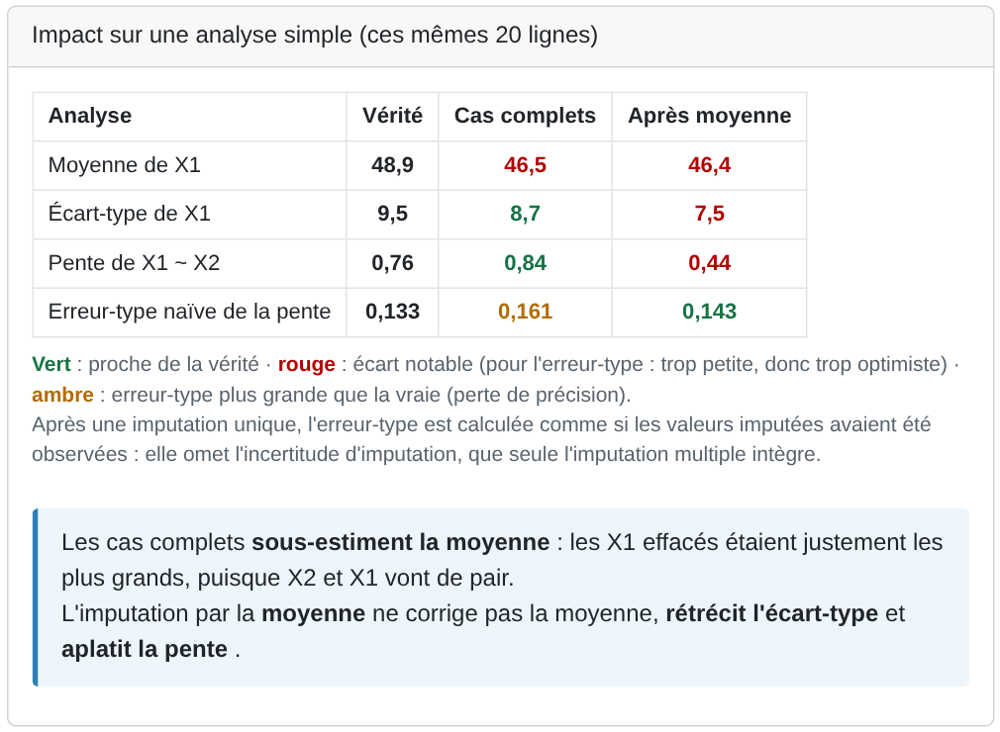
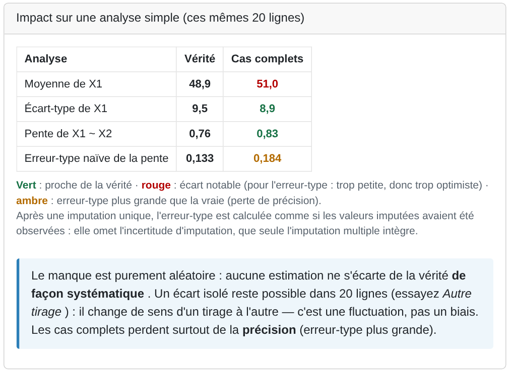
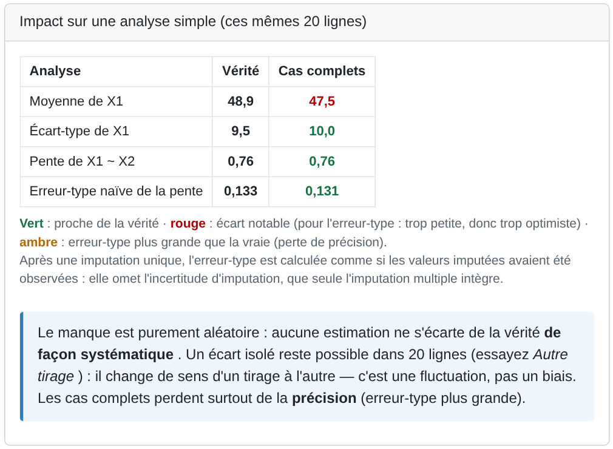
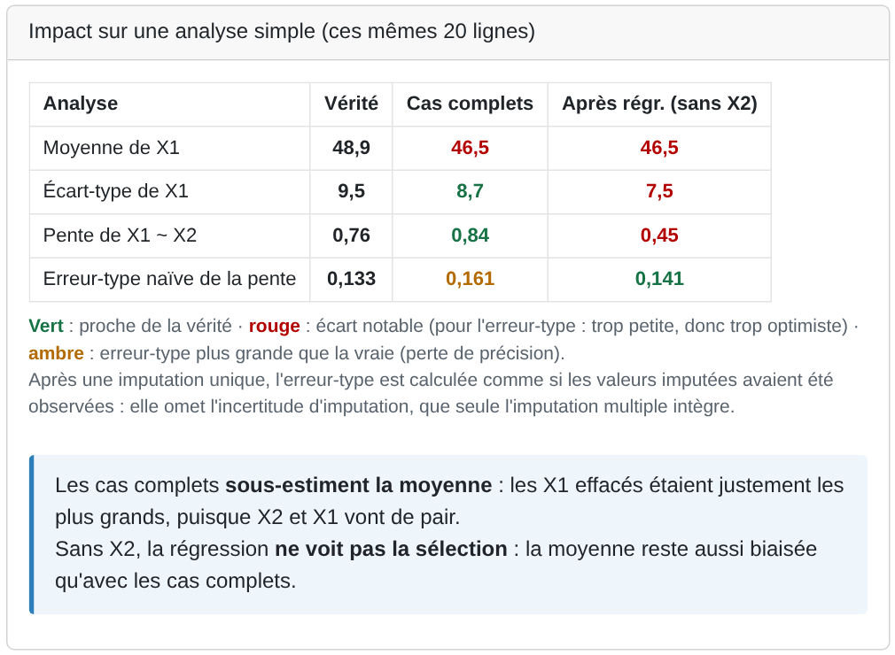

# Le problème des données manquantes {#sec-introduction}

```{r}
#| include: false
source("_setup.R")
```

Dans presque toute étude empirique, une partie des données est absente : un
répondant saute une question, un instrument tombe en panne, un participant
abandonne l'étude. Ce chapitre pose le problème, en fixe le vocabulaire, puis
vous emmène le *manipuler* dans le **bac à sable** de l'onglet **Introduction**
de *simManquant*. Gardez l'application ouverte à côté : ce chapitre se lit une
main sur la souris.

## L'ubiquité et le coût du manque

Les données manquantes sont la règle plutôt que l'exception. Elles apparaissent à
la collecte (un capteur défaillant, une question sensible éludée), en cours
d'étude (l'attrition d'un suivi longitudinal) ou au traitement (une fusion de
fichiers imparfaite). Les ignorer a un coût triple :

- une **perte de puissance**, car supprimer les observations incomplètes réduit la
  taille d'échantillon effective ;
- un **biais** possible des estimations, si les données présentes ne représentent
  plus la population visée ;
- une **variance mal estimée**, si l'on comble les trous par des valeurs traitées à
  tort comme certaines.

::: {.callout-note}
La difficulté n'est pas seulement *combien* de données manquent, mais *pourquoi*
elles manquent. Cette raison — le **mécanisme** de manque — décide quelles
méthodes de traitement sont valides. Elle est formalisée au @sec-mecanismes ; on
la rencontre ici, concrètement, dès le bac à sable.
:::

## Trois questions à se poser

Devant un jeu incomplet, trois questions orientent toute l'analyse :

1. **Combien ?** Quelle proportion de valeurs manque, globalement et par variable ?
2. **Où ?** Le manque se concentre-t-il sur quelques variables, ou se disperse-t-il ?
3. **Pourquoi ?** Le manque est-il lié aux données elles-mêmes — et si oui, à la
   partie observée ou à la partie manquante ?

Les deux premières relèvent de la description (@sec-simuler-visualiser) ; la
troisième, la plus lourde de conséquences, est celle que le bac à sable rend
visible.

## Une notation

Suivant Rubin [-@rubin1976], notons $Y$ l'ensemble des données que l'on aurait si
rien ne manquait. On le partitionne en une partie **observée** $Y_{\text{obs}}$ et
une partie **manquante** $Y_{\text{mis}}$. On introduit enfin un **indicateur de
réponse** $R$, valant $1$ là où la valeur est observée et $0$ là où elle manque.
Tout le problème tient dans le lien entre $R$ et $Y$ : le fait qu'une valeur
manque dépend-il de $Y$, et de quelle partie ?

L'application emploie aussi l'indicateur inverse, $M = 1 - R$, qui vaut $1$
**quand la valeur manque**. C'est lui qu'on corrèle avec les autres variables pour
chercher de quoi dépend le manque; les deux notations disent la même chose.

## Trois mécanismes, trois images

Avant toute définition formelle, regardons ce que font les trois mécanismes sur un
même jeu de données. Dans la @fig-trois-mecanismes, $X_1$ et $X_2$ sont deux
variables corrélées; 35 % des valeurs de $X_1$ sont effacées selon trois règles
différentes. Parce qu'il s'agit d'une simulation, on peut encore placer chaque
point effacé à sa vraie position (en orange).

```{r}
#| label: fig-trois-mecanismes
#| fig-cap: "Le même jeu de 300 observations, amputé de trois façons. En orange, les valeurs de $X_1$ effacées, montrées à leur vraie position. Le trait vert indique la vraie moyenne de $X_1$; le trait bleu, la moyenne des seules valeurs restantes. Sous MCAR, les trous sont dispersés au hasard et les deux moyennes coïncident. Sous MAR, les trous suivent $X_2$, une variable observée : ils se concentrent à droite. Sous MNAR, ils suivent $X_1$ elle-même : ils se concentrent en haut. Dans les deux derniers cas, la moyenne des valeurs restantes est trop basse."
#| fig-width: 9
#| fig-height: 3.6
d <- sim_mvn(300, p = 2, rho = 0.7, graine = 11)
set.seed(12)
m <- list(
  MCAR = runif(300) < 0.35,
  MAR  = runif(300) < p_manque(d$X2, force = 3),
  MNAR = runif(300) < p_manque(d$X1, force = 3))
g <- do.call(rbind, lapply(names(m), function(k)
  data.frame(meca = k, X1 = d$X1, X2 = d$X2,
             statut = ifelse(m[[k]], "Manquant", "Observé"))))
g$meca <- factor(g$meca, levels = c("MCAR", "MAR", "MNAR"),
                 labels = c("MCAR : au hasard", "MAR : selon X2 (observée)", "MNAR : selon X1 (manquante)"))
moy <- do.call(rbind, lapply(split(g, g$meca), function(s)
  data.frame(meca = s$meca[1], vrai = mean(s$X1), obs = mean(s$X1[s$statut == "Observé"]))))
ggplot(g, aes(X2, X1, colour = statut)) +
  geom_point(size = 1.4, alpha = 0.8) +
  geom_hline(data = moy, aes(yintercept = vrai), colour = COUL_ACC, linewidth = 0.9, linetype = "dashed") +
  geom_hline(data = moy, aes(yintercept = obs), colour = COUL_OBS, linewidth = 0.9) +
  facet_wrap(~ meca) +
  scale_colour_manual(values = c(Observé = COUL_OBS, Manquant = COUL_NA), name = NULL) +
  sx_fr() + sy_fr() +
  labs(x = expression(X[2]), y = expression(X[1] ~ "(valeur vraie)"))
```

La figure contient déjà toute la suite du manuel. Le **MCAR** ne déforme rien : il
réduit seulement le nombre d'observations. Le **MAR** déforme la moyenne, mais la
cause du manque, $X_2$, est observée pour tous : on pourra s'en servir pour
corriger. Le **MNAR** déforme la moyenne et la cause du manque disparaît avec la
donnée : sur de vraies données, on ne verrait jamais les points orange.

## Voir les trois mécanismes dans le bac à sable {#sec-intro-bac}

Le bac à sable travaille sur un tout petit jeu — **20 observations, quatre
variables** $X_1$ à $X_4$ — assez petit pour se lire d'un coup d'œil. C'est
toujours $X_1$ qui perd des valeurs ; $X_2$ est fortement liée à $X_1$ et jouera
le rôle de **prédicteur du manque**. Sous MAR et MNAR, ce sont les $k$ valeurs les
plus élevées du prédicteur qui provoquent le manque, pour que le motif soit net;
sous MCAR, les $k$ lignes sont tirées au sort. Un code de couleurs révèle la cause
du manque : **rouge** pour la valeur en cause, **rouge pâle** pour une case devenue
manquante (NA), **bleu** pour une valeur imputée.

Trois mécanismes se distinguent par ce dont dépend le manque. En bref (le
@sec-mecanismes les formalise) :

- **MCAR** — le manque est *complètement aléatoire*, lié à rien ;
- **MAR** — il dépend d'une variable **observée** (ici $X_2$) ;
- **MNAR** — il dépend de la valeur **manquante elle-même** ($X_1$).

::: {.app}
**À l'application —** Onglet **Introduction**, sous-onglet **Bac à sable**. Réglez
le **Mécanisme de manque** sur **MCAR**, laissez le **Nombre de valeurs
manquantes** à 5, puis basculez la **Vue** de *Avant* à *Après*. Recommencez pour
**MAR**, puis pour **NMAR**, en observant à chaque fois quelles cellules sont en
rouge *avant*, et lesquelles deviennent manquantes *après*.
:::

{#fig-cap-bac-avant}

::: {.voir}
**Ce qu'on doit voir —** Sous **MCAR**, aucune couleur *avant* : le manque frappe
au hasard, sans motif. Sous **MAR**, les valeurs **élevées de $X_2$** sont en
rouge (@fig-cap-bac-avant), et c'est dans ces mêmes lignes que $X_1$ disparaît —
le manque suit une variable *observée*. Sous **MNAR**, ce sont les valeurs
**élevées de $X_1$ elles-mêmes** qui sont en rouge… et qui s'effacent : la preuve
disparaît avec la donnée. C'est l'intuition centrale de tout le manuel — sous
MNAR, l'information qui expliquerait le manque est précisément celle qui manque.
:::

## Ce qui est en jeu : l'impact sur une analyse

Le mécanisme ne serait qu'une curiosité s'il ne changeait pas les **résultats**.
La carte **Impact sur une analyse simple** du bac à sable suit quatre quantités :
la **moyenne** et l'**écart-type de $X_1$**, puis la **pente** de la régression de
$X_1$ sur $X_2$ et son **erreur-type naïve**. Elles sont comparées entre la
**vérité** (les 20 lignes complètes), les **cas complets** et l'**imputation**
choisie.

Le code de couleurs est le suivant. Une estimation **verte** est proche de la
vérité; une estimation **rouge** s'en écarte nettement. Pour l'erreur-type, le
rouge signale une valeur **trop petite** — l'analyse se croit plus précise qu'elle
ne l'est — et l'**ambre** une valeur plus grande que la vraie : on a perdu de la
précision, ce qui est le prix normal d'un échantillon réduit.

L'erreur-type est dite *naïve* après une imputation unique : elle est calculée
comme si les valeurs imputées avaient été observées. Elle donne ainsi une intuition
du problème, mais ne représente pas l'incertitude complète due aux données
manquantes; l'imputation multiple l'intègre explicitement (@sec-imputation-multiple).

::: {.app}
**À l'application —** Toujours dans le bac à sable, passez la **Vue** à *Après* et
réglez l'**Imputation** successivement sur *Aucune*, *Par la moyenne*, *Par
régression*, puis *Par régression + erreur*, sous chacun des trois mécanismes.
Suivez la carte **Impact** et lisez l'encadré qui l'accompagne, puis la carte
**Pour bien comprendre**.
:::

![Sous **MAR**, vue *Après*, imputation *Par régression*. Les cinq valeurs de $X_1$ effacées sont remplacées (en bleu) par des valeurs prédites à partir de $X_2$, $X_3$ et $X_4$. La carte **Impact** montre que les cas complets sous-estiment la moyenne (46,5 contre 48,9), alors que la régression la récupère (49,6) et rétablit l'écart-type (9,5); son erreur-type naïve (0,101), en revanche, est trop petite. Le graphique *Où tombent les valeurs imputées ?* montre pourquoi : les points orange tombent exactement sur une droite.](images/cap-bac-mar-regression.png){#fig-cap-bac-regression}

::: {.voir}
**Ce qu'on doit voir —** Sous **MCAR**, les estimations ponctuelles ne s'écartent
pas *systématiquement* de la vérité; les cas complets perdent seulement de la
précision (erreur-type en ambre). Sous **MAR**, les cas complets sous-estiment la
**moyenne** (rouge) — mais pas nécessairement la **pente** : un point subtil sur
lequel on reviendra (@sec-cas-complets). La régression récupère la moyenne (@fig-cap-bac-regression). L'imputation par la moyenne, elle, **rétrécit
l'écart-type** et **écrase la pente** (@fig-cap-bac-moyenne). Sous **MNAR**, les
méthodes fondées sur MAR ne récupèrent pas la vérité : l'information qui
expliquerait la sélection manque.
:::

{#fig-cap-bac-moyenne width="75%"}

Ces effets — le biais de la moyenne, le rétrécissement de l'écart-type,
l'écrasement de la pente et une incertitude trop optimiste après imputation unique
— ne tiennent pas au petit format du jeu. Sur beaucoup de répétitions, le premier
apparaît comme un **décalage moyen** sous ce MAR particulier; les suivants découlent
de la façon dont les valeurs manquantes sont comblées. Il vaut la peine de les
nommer précisément, car ils sont de natures différentes.

**Le biais des cas complets** vient d'une sélection cachée. Sous MAR, garder les
seules lignes complètes n'est pas tirer au hasard : on conserve surtout celles où
$X_2$ est basse — c'est là que $X_1$ survit — et comme $X_1$ suit $X_2$, la
moyenne calculée sur ces lignes penche du mauvais côté. Rien, dans les données
présentes, ne signale cette dérive : c'est le rouge que porte la carte **Impact**
sur la moyenne, sous MAR.

**Le rétrécissement de la variance** est un effet distinct, propre à l'imputation
par une valeur unique. Remplacer chaque manquant par la même valeur centrale
empile des points au milieu de la distribution et réduit *artificiellement* la
dispersion : l'écart-type après imputation est plus petit que le vrai. La facture
se paie plus tard : les **erreurs-types naïves** calculées sur ces données
paraissent rassurantes alors qu'elles sont **trompeusement petites**, et le lien
entre variables — la pente — s'aplatit vers zéro.

**L'imputation par régression + erreur** illustre le pas suivant. En ajoutant à
chaque prédiction un résidu tiré au hasard, elle rend aux valeurs imputées leur
dispersion naturelle. Mais un seul tirage fait bouger un peu la moyenne et la
pente, et l'erreur-type naïve reste trop petite : il faudra **répéter**
l'imputation pour mesurer cette part de hasard. C'est l'idée de l'imputation
multiple.

### Fluctuation ou biais ?

Avec 20 lignes, le hasard seul suffit à écarter une estimation de la vérité. Sous
MCAR, le bouton **Autre tirage au hasard** retire un autre ensemble de lignes
choisies au sort (tirage n° 2, puis n° 3, etc.); le bouton **Tirage initial**
revient au tirage n° 1. Ces tirages sont toujours les mêmes : le tirage n° 5 de
votre écran est celui de ce guide.

::: {.app}
**À l'application —** Mécanisme **MCAR**, **Vue** *Après*, **Imputation**
*Aucune*. Cliquez plusieurs fois sur **Autre tirage au hasard** en surveillant la
colonne *Cas complets* de la carte **Impact**.
:::

::: {.voir}
**Ce qu'on doit voir —** Au tirage n° 1, les estimations sont vertes. Au tirage
n° 2, la moyenne des cas complets est **trop haute** (51,0 contre 48,9); au
tirage n° 5, elle est **trop basse** (47,5) (@fig-cap-bac-tirages). D'un tirage à
l'autre, l'une ou l'autre estimation devient parfois rouge, mais **jamais dans le
même sens**. C'est la signature d'une **fluctuation d'échantillonnage**. Un
**biais**, lui, pousse toujours dans la même direction : sous MAR, la moyenne des
cas complets est trop basse quel que soit le jeu.
:::

::: {#fig-cap-bac-tirages layout-ncol=2}




Deux tirages MCAR du bac à sable. Les écarts à la vérité changent de sens : c'est du hasard, non un biais.
:::

## Le prédicteur du manque {#sec-intro-predicteur}

Sous MAR, on vient de voir la régression se rapprocher de la moyenne vraie. Mais
elle ne le fait qu'à une condition : que le **prédicteur du manque** — ici $X_2$ —
soit **dans le modèle d'imputation**. L'oublier peut laisser subsister un biais
important, même si le mécanisme dépend seulement de l'observé. C'est sans doute
l'angle mort le plus fréquent en pratique.

::: {.app}
**À l'application —** Dans le bac à sable, choisissez **MAR**, **Vue** *Après*,
**Imputation** *Par régression*. Un nouveau réglage apparaît, **Modèle
d'imputation** : basculez-le de *Complet — inclut le prédicteur X2* à
*Incomplet — oublie X2*, en surveillant la carte **Impact**.
:::

{#fig-cap-bac-incomplet width="75%"}

::: {.voir}
**Ce qu'on doit voir —** En mode *complet*, la colonne « Après régression » se
rapproche de la vérité. En mode *incomplet*, la récupération disparaît (@fig-cap-bac-incomplet) : la moyenne redevient biaisée. La leçon est capitale :
le manque est toujours MAR — il dépend d'une variable observée — mais une
imputation ne peut en tirer parti que si son modèle inclut les variables
pertinentes, dont le prédicteur du manque et les variables liées à l'analyse.
:::

## Lire l'écran : du bac à sable à l'enquête réelle

Le bac à sable montre simultanément ce qu'une enquête réelle sépare : le processus
qui crée le manque, les valeurs avant leur effacement et les résultats après
traitement. Servez-vous-en pour apprendre la logique, mais ne transportez pas
toutes ses possibilités dans une enquête sans les transformer.

| À l'écran | Ce que l'on peut apprendre | Ce que l'on ne pourra pas voir dans une enquête réelle |
|---|---|---|
| Couleur rouge dans la vue *Avant* | La variable utilisée par la simulation pour créer le manque. | La « cause » réelle du manque, sauf si elle est documentée à la collecte. |
| Carte *Impact* et colonne **Vérité** | L'écart entre une méthode et le paramètre générateur, pour ce scénario. | Le biais exact d'une méthode : la vérité complète est inconnue. |
| Carte *Signature* | La différence logique entre une dépendance à l'observé et à la vraie valeur manquante. | Une preuve que le mécanisme réel est MAR plutôt que MNAR. |

: Ce que le bac à sable montre, et ce qu'une étude réelle cache. {#tbl-bac-reel}

Le passage de la simulation au terrain est donc toujours le même : on remplace la
comparaison à la vérité par une **description du manque**, un **argument sur la
collecte**, des **diagnostics de plausibilité** et, si nécessaire, une **analyse de
sensibilité**.

## Les patrons de manquants

Revenons à la question « **où ?** ». On appelle **patron** la disposition des
valeurs présentes et absentes dans le tableau. On en distingue trois types :
**univarié** (une seule variable touchée), **monotone** (les variables s'ordonnent
de sorte que, dès qu'une valeur manque, les suivantes manquent aussi — fréquent en
attrition longitudinale), et **quelconque** (aucune régularité). Le
@sec-simuler-visualiser les illustre (@fig-trois-patrons) et apprend à les lire
dans l'onglet **Données & visualisation**.

## Feuille de route

Le @sec-mecanismes formalise les trois mécanismes. On apprend ensuite à
**visualiser** le manque (@sec-simuler-visualiser), à le **diagnostiquer** (@sec-diagnostic-little), à le **traiter** (@sec-cas-complets,
@sec-imputation-multiple, @sec-fiml), à **évaluer** les méthodes (@sec-etude-simulation, @sec-qualite-imputation), à **encadrer** le cas non
aléatoire (@sec-sensibilite-mnar), puis à appliquer la démarche complète (@sec-exemple-guide, @sec-donnees-reelles).

## Exercices {.unnumbered}

**1.1** *(Bac à sable.)* Sous **MCAR**, faites glisser le **Nombre de valeurs
manquantes** de 1 à 10, puis parcourez les tirages n° 1 à 10 avec **Autre tirage
au hasard**. Les écarts à la vérité vont-ils toujours dans le même sens ? Formulez en
une phrase pourquoi la quantité de manque, sous MCAR, ne crée pas de biais.
*(Solution : @sec-sol-intro.)*

**1.2** *(Bac à sable.)* Sous **MAR**, comparez l'imputation *Par la moyenne* et
*Par régression* (mode complet). Laquelle récupère la pente ? Laquelle l'écrase ?
Reliez votre observation à ce que vous avez lu plus haut sur le **rétrécissement
de la variance**.

**1.3** *(Bac à sable.)* Reprenez la manipulation du @sec-intro-bac, mais réglez
le **Mécanisme de manque** sur **MCAR** au lieu de **MAR**, avec **Vue** *Après*
et **Imputation** *Aucune* (c'est-à-dire les cas complets). La carte **Impact**
signale-t-elle encore un biais sur la **moyenne** de $X_1$ ? Expliquez en une
phrase pourquoi le passage de MAR à MCAR fait disparaître ce biais.

**1.4** *(Bac à sable.)* Sous **MAR**, **Vue** *Après*, comparez la ligne
**Erreur-type naïve de la pente** pour *Par régression* et *Par régression +
erreur*. Les deux sont-elles en rouge ? Pourquoi l'ajout d'un résidu aléatoire,
qui rétablit l'écart-type, ne suffit-il pas à rendre l'erreur-type honnête ?
