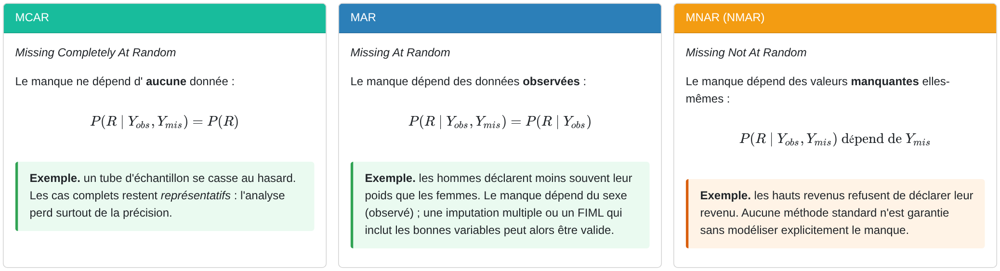
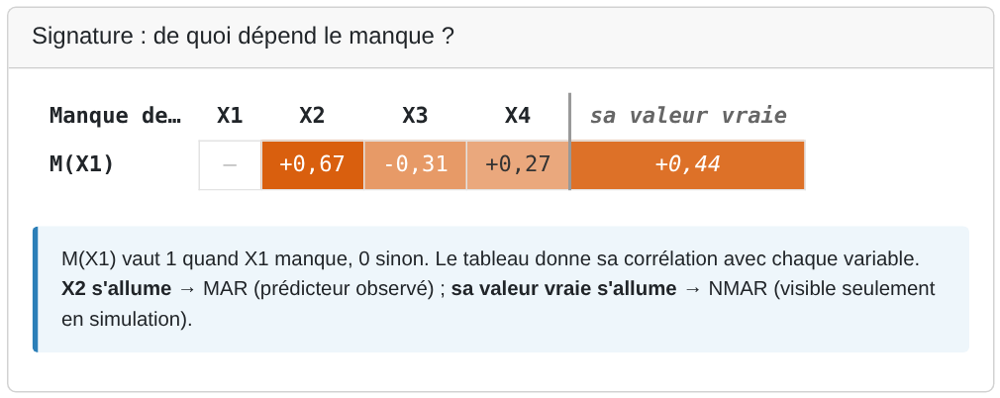
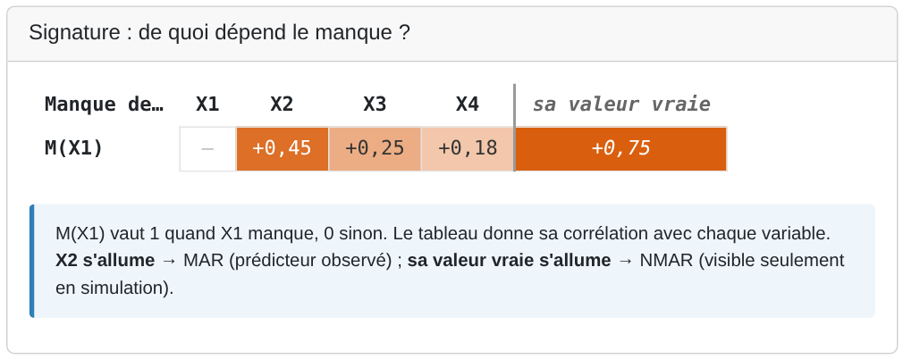

# Les mécanismes : MCAR, MAR, MNAR {#sec-mecanismes}

```{r}
#| include: false
source("_setup.R")
```

Le mécanisme de manque est la loi de probabilité qui régit *quelles* valeurs
disparaissent. C'est la notion centrale du domaine : elle décide si une méthode de
traitement est valide ou trompeuse. Ce chapitre formalise les trois mécanismes de
Rubin [-@rubin1976], les rend tangibles dans le **bac à sable**, et vous fait
**reconnaître** un mécanisme sur des cas concrets dans le sous-onglet **Quiz** de
l'onglet **Introduction**.

## La notation de Rubin

Reprenons les notations du @sec-introduction : $Y$ désigne les données complètes,
partitionnées en $Y_{\text{obs}}$ (observé) et $Y_{\text{mis}}$ (manquant), et $R$
est l'indicateur de réponse ($R = 1$ si observé, $R = 0$ si manquant). Un mécanisme
est une spécification de la loi conditionnelle

$$
P(R \mid Y_{\text{obs}}, Y_{\text{mis}}, \xi),
$$

où $\xi$ regroupe d'éventuels paramètres propres au processus de manque. Les trois
mécanismes se distinguent par *ce dont dépend* cette probabilité.

Pour rendre les définitions concrètes, on s'appuie sur le principe du bac à sable :
$X_1$ perd des valeurs avec une probabilité qui dépend d'un **prédicteur du
manque** choisi. C'est ce choix — *rien*, une variable *observée*, ou la variable
*elle-même* — qui définit le mécanisme. Les variables du jeu sont corrélées entre
elles (en particulier $X_1$ et $X_2$), de sorte qu'amputer $X_1$ selon un
prédicteur laisse une **trace** repérable, que l'on apprendra à lire plus bas.

{#fig-cap-concepts}

## MCAR — manque complètement aléatoire

Sous **MCAR** (*Missing Completely At Random*), la probabilité de manquer ne dépend
d'aucune donnée :

$$
P(R \mid Y_{\text{obs}}, Y_{\text{mis}}, \xi) = P(R \mid \xi).
$$

Le fait qu'une valeur manque est indépendant de tout ce qu'on aurait pu mesurer. Le
sous-échantillon des cas complets est alors un **échantillon aléatoire** de la
population : les estimations restent sans biais, seule la précision diminue. Dans le
bac à sable, la vue *Avant* ne colore alors **aucune** cellule.

::: {.callout-note}
**Exemple.** Un tube d'échantillon se casse au laboratoire, au hasard. La perte est
sans lien avec le contenu du tube : MCAR.
:::

## MAR — manque aléatoire conditionnel

Sous **MAR** (*Missing At Random*), la probabilité de manquer dépend des données
**observées**, mais pas des valeurs manquantes elles-mêmes :

$$
P(R \mid Y_{\text{obs}}, Y_{\text{mis}}, \xi) = P(R \mid Y_{\text{obs}}, \xi).
$$

L'appellation « aléatoire » est trompeuse : le manque *n'est pas* purement
aléatoire, mais il le redevient **une fois qu'on conditionne sur les variables
observées**. Deux personnes qui ont la même valeur de $X_2$ ont la même chance de
perdre $X_1$, quelle que soit leur vraie valeur de $X_1$. C'est la clé qui rend
l'imputation multiple valide (@sec-imputation-multiple) — à condition d'inclure le
bon prédicteur, comme on l'a vu au bac à sable (@sec-intro-predicteur).

Une analyse des seuls cas observés peut alors être biaisée, en particulier pour une
moyenne ou une comparaison qui ignore $X_2$. Ce n'est toutefois pas une règle pour
tout paramètre : dans une régression correctement spécifiée, certains coefficients
conditionnels peuvent rester peu biaisés lorsque le manque ne dépend que des
prédicteurs du modèle (@sec-cc-regression). Comme $X_2$ est disponible pour
**tous** (y compris les lignes où $X_1$ manque), une méthode qui l'exploite peut
souvent réduire le biais et récupérer de la précision.

::: {.callout-note}
**Exemple.** Les hommes déclarent moins souvent leur poids que les femmes. Le manque
dépend du sexe, qui est enregistré : MAR.
:::

## MNAR — manque non aléatoire

Sous **MNAR** (*Missing Not At Random*, aussi noté NMAR), la probabilité de manquer
dépend des valeurs **manquantes** elles-mêmes, même après conditionnement sur
l'observé :

$$
P(R \mid Y_{\text{obs}}, Y_{\text{mis}}, \xi)\ \text{dépend de}\ Y_{\text{mis}}.
$$

Ici, le prédicteur *est* la variable amputée : les grandes valeurs de $X_1$
disparaissent préférentiellement, et aucune variable observée ne suffit à rétablir
l'équilibre.

::: {.callout-warning}
**Exemple.** Les personnes à haut revenu refusent plus souvent de déclarer leur
revenu. Le manque dépend de la valeur manquante elle-même : MNAR. Aucune méthode
standard n'est garantie sans modéliser explicitement le processus de manque (@sec-sensibilite-mnar).
:::

## La probabilité de manquer, en image

L'application fabrique le manque avec une **courbe logistique** : la probabilité
qu'une valeur manque croît en S avec le prédicteur, de presque 0 pour ses valeurs
faibles à presque 1 pour ses valeurs élevées (ou l'inverse, si l'on choisit *Valeurs
faibles vers manque*). La @fig-proba-manque montre cette probabilité pour chaque
mécanisme, tracée contre $X_2$ (observée) puis contre $X_1$ (la variable amputée).

```{r}
#| label: fig-proba-manque
#| fig-cap: "Probabilité que $X_1$ manque, selon $X_2$ (à gauche) et selon la vraie valeur de $X_1$ (à droite), pour une corrélation de 0,7 entre les deux variables et 35 % de cas incomplets. Sous MCAR, la probabilité est plate partout. Sous MAR, elle est une fonction exacte de $X_2$ (courbe en S), et sa relation avec $X_1$ n'est qu'indirecte, d'où un nuage. Sous MNAR, c'est l'inverse : la courbe est exacte en $X_1$, et seulement approximative en $X_2$."
#| fig-width: 9
#| fig-height: 4
d <- sim_mvn(600, p = 2, rho = 0.7, graine = 21)
pr <- list(MCAR = rep(0.35, 600), MAR = p_manque(d$X2, 3), MNAR = p_manque(d$X1, 3))
g <- do.call(rbind, lapply(names(pr), function(k) rbind(
  data.frame(meca = k, axe = "selon X2 (observée)", x = d$X2, p = pr[[k]]),
  data.frame(meca = k, axe = "selon X1 (valeur vraie)", x = d$X1, p = pr[[k]]))))
g$meca <- factor(g$meca, levels = c("MCAR", "MAR", "MNAR"))
g$axe <- factor(g$axe, levels = c("selon X2 (observée)", "selon X1 (valeur vraie)"))
ggplot(g, aes(x, 100 * p, colour = meca)) +
  geom_point(size = 0.9, alpha = 0.55) +
  facet_wrap(~ axe) +
  scale_colour_manual(values = c(MCAR = GRIS, MAR = COUL_OBS, MNAR = COUL_NA), name = NULL) +
  scale_y_continuous(labels = pct_axe, limits = c(0, 100),
                     breaks = seq(0, 100, 25)) +
  sx_fr() +
  guides(colour = guide_legend(override.aes = list(size = 3, alpha = 1))) +
  labs(x = NULL, y = "Probabilité que X1 manque")
```

Cette figure explique pourquoi les mécanismes sont si difficiles à départager sur
le terrain. Dès que $X_1$ et $X_2$ sont corrélées, un MAR produit *aussi* un lien
entre le manque et $X_1$ (nuage bleu à droite), et un MNAR produit *aussi* un lien
entre le manque et $X_2$ (nuage orange à gauche). La différence ne tient pas à
l'existence d'un lien, mais à **la variable par laquelle il passe**.

## La signature d'un mécanisme

Chaque mécanisme laisse une **signature** mesurable : la façon dont l'indicateur de
manque se lie à deux quantités — la variable **observée** $X_2$ (le prédicteur
candidat) et la **vraie** valeur de $X_1$ (connue seulement parce qu'on simule).

- Sous **MCAR**, le manque ne se lie à rien : ni à $X_2$, ni à la vraie valeur de
  $X_1$. Il est pur bruit.
- Sous **MAR**, il se lie **le plus fortement** à la variable observée $X_2$; s'il
  se lie aussi à la vraie valeur de $X_1$, c'est seulement par l'intermédiaire de
  $X_2$ : une fois $X_2$ pris en compte, ce lien disparaît.
- Sous **MNAR**, il se lie **le plus fortement** à la vraie valeur de $X_1$ — la
  partie précisément manquante — et cette liaison subsiste même après avoir tenu
  compte de l'observé.

La carte **Signature : de quoi dépend le manque ?** du bac à sable mesure ces liens
par une corrélation entre l'indicateur $M(X_1)$ (1 si $X_1$ manque, 0 sinon) et
chaque variable. Plus la couleur est intense, plus le lien est fort.

::: {.app}
**À l'application —** Onglet **Introduction**, sous-onglet **Bac à sable**, **Vue**
*Avant*. Comparez la carte **Signature** sous **MAR** puis sous **NMAR**, ainsi que
la colonne qui se colore en rouge dans le tableau de données.
:::

::: {#fig-cap-signatures layout-ncol=2}




La carte **Signature** du bac à sable sous les deux mécanismes non aléatoires. Dans les deux cas, plusieurs cellules s'allument; c'est la cellule la plus intense qui désigne la variable dont dépend le manque.
:::

::: {.voir}
**Ce qu'on doit voir —** Sous **MAR**, le rouge du tableau est sur $X_2$, une
variable *observée*, et la carte **Signature** donne son lien le plus fort à $X_2$
(+0,67); la valeur vraie de $X_1$ s'allume aussi (+0,44), mais moins, parce que
$X_1$ suit $X_2$ (@fig-cap-signatures). Sous **NMAR**, le rouge passe sur $X_1$, la
variable qui *disparaît*, et la valeur vraie devient le lien le plus fort (+0,75).
:::

::: {.callout-tip}
La liaison entre le manque et la **vraie** valeur de $X_1$ n'est mesurable qu'en
**simulation**. Sur de vraies données, cette valeur est justement ce qui manque —
c'est pourquoi distinguer MAR de MNAR à partir des seules données observées est
**impossible** (@sec-diagnostic-little).
:::

## Reconnaître le mécanisme dans la nature

Formaliser les définitions ne suffit pas ; la vraie compétence est de **repérer**
le mécanisme derrière une situation concrète. Une seule question tranche presque
toujours : *le manque dépend-il d'une variable **observée** (MAR), ou de la valeur
**manquante** elle-même (MNAR) ?*

::: {.app}
**À l'application —** Onglet **Introduction**, sous-onglet **Quiz**. Pour chacun des
18 scénarios, classez le mécanisme (MCAR, MAR ou NMAR), cliquez sur **Valider**,
lisez l'explication, puis passez à la **Question suivante**. Le bouton
**Recommencer** mélange les questions.
:::

{#fig-cap-quiz width="85%"}

::: {.voir}
**Ce qu'on doit voir —** Les pièges tiennent presque toujours à un mot. « Les plus
malades quittent l'étude » sonne MNAR — mais si la **gravité à l'admission est
enregistrée**, le manque dépend d'une variable observée : MAR. À l'inverse, « le
capteur cesse d'émettre quand il fait froid » cache un MNAR, car le froid *est* la
température qui manque. Cherchez toujours : *de quoi, d'observé ou de manquant,
dépend le manque ?*
:::

## Ignorabilité

La distinction pratique la plus utile oppose les mécanismes **ignorables** et
**non ignorables**. Pour l'inférence par vraisemblance ou bayésienne, le mécanisme
est *ignorable* lorsque deux conditions sont réunies : les données sont MAR (ou
MCAR, cas particulier), et les paramètres du processus de manque $\xi$ sont
distincts de ceux du modèle d'intérêt. On peut alors estimer **sans modéliser** le
processus de manque : l'imputation multiple et le maximum de vraisemblance (FIML)
s'appliquent directement.

Sous MNAR, le mécanisme est **non ignorable** : la validité des estimations exige de
poser un modèle pour $P(R \mid Y_{\text{mis}})$, invérifiable par nature. On se
rabat alors sur l'analyse de sensibilité (@sec-sensibilite-mnar).

## Tableau de synthèse

| Mécanisme | Le manque dépend de… | Cas complets | Imputation multiple / FIML |
|-----------|----------------------|--------------|----------------------------|
| **MCAR**  | rien | généralement sans biais; moins efficace | valides si le modèle est adéquat |
| **MAR**   | valeurs observées | peuvent être biaisés; cela dépend du paramètre et du modèle d'analyse | valides si MAR est défendable et que le modèle est adéquat |
| **MNAR**  | valeurs manquantes | peuvent être biaisés | non garantis; analyse de sensibilité ou modèle du manque requis |

: Les trois mécanismes et la validité des méthodes. {#tbl-synthese-mecanismes}

## Lire l'écran : mécanisme simulé, hypothèse de terrain

Dans le **Quiz** et le bac à sable, l'application connaît le mécanisme parce qu'elle
le programme. Dans une étude réelle, MCAR, MAR et MNAR ne sont jamais des étiquettes
produites automatiquement par les données. Utilisez plutôt les sorties comme des
éléments d'un argument :

- les patrons et les associations du manque avec des variables **observées** rendent
  certaines explications MAR plus plausibles;
- le contexte de collecte indique si une valeur non observée pourrait elle-même
  affecter la réponse, ce qui maintient l'hypothèse MNAR en jeu;
- le choix du modèle d'imputation doit inclure l'issue, les variables de l'analyse
  et les auxiliaires qui prédisent la valeur ou le manque.

Le verdict méthodologique ne doit donc jamais être « MAR prouvé ». La formulation
défendable est plutôt : « Nous analysons sous MAR, compte tenu des informations
observées et du processus de collecte décrit; nous examinons la sensibilité à une
déviation MNAR plausible. »

## Exercices {.unnumbered}

**2.1** Sous **MAR**, imaginez que le manque dépende **plus fortement** du
prédicteur $X_2$ (une courbe en S plus abrupte dans la @fig-proba-manque). Comment
évoluent, selon vous, le **biais** des cas complets sur la moyenne de $X_1$ et
l'**intensité** de la liaison entre le manque et $X_2$ dans la carte
**Signature** ? *(Solution : @sec-sol-mecanismes.)*

**2.2** Imaginez un manque MAR où le prédicteur est $X_3$ plutôt que $X_2$. Le biais
sur la moyenne de $X_1$ dépend-il de la **force du lien** entre $X_1$ et le
prédicteur choisi ? Expliquez pourquoi un prédicteur faiblement corrélé à $X_1$
laisse peu de biais à corriger… mais aussi peu de biais tout court.

**2.3** *(Bac à sable.)* Sur la carte **Impact** (Vue *Après*, Imputation
*Aucune*), comparez la **pente de la régression de $X_1$ sur $X_2$** sous **MCAR**
puis sous **NMAR**. Sous lequel reste-t-elle fidèle à la vérité ? Expliquez
pourquoi MCAR préserve la relation entre $X_1$ et $X_2$ alors que MNAR peut la
fausser.

**2.4** *(Quiz.)* Parcourez les 18 scénarios du **Quiz** et notez, pour chacun, la
variable — observée ou manquante — dont dépend le manque. Lesquels sont
**ignorables** ? Lesquels exigeraient une analyse de sensibilité ?

**2.5** Dans la carte **Signature** sous MAR, la valeur vraie de $X_1$ s'allume
(+0,44) alors que le manque ne dépend pas d'elle. Expliquez ce lien à l'aide de la
@fig-proba-manque. Que faudrait-il calculer pour montrer qu'il disparaît « une fois
$X_2$ pris en compte » ?
