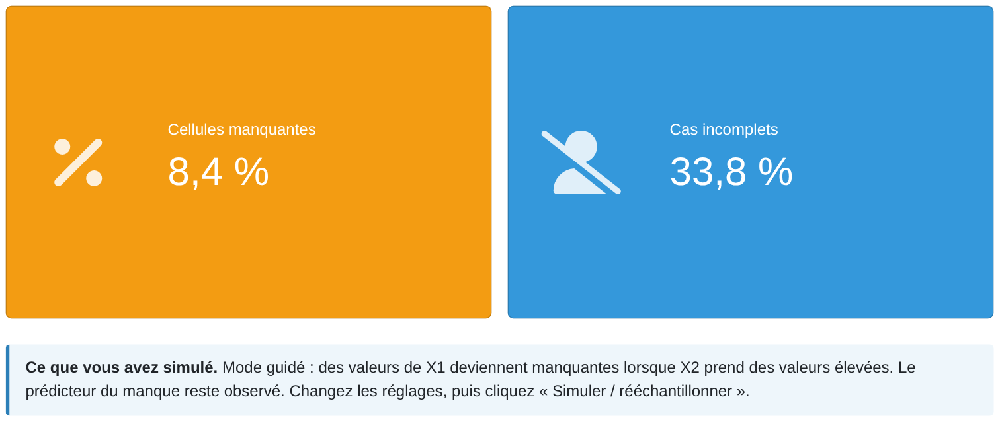
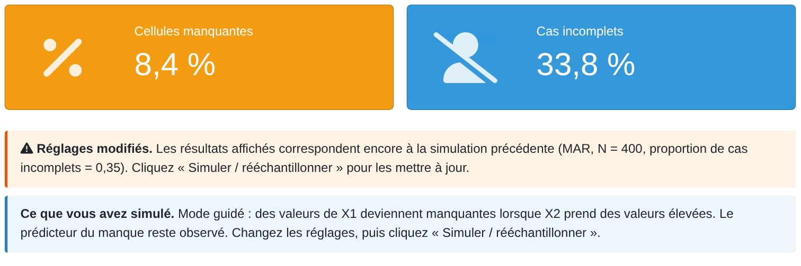
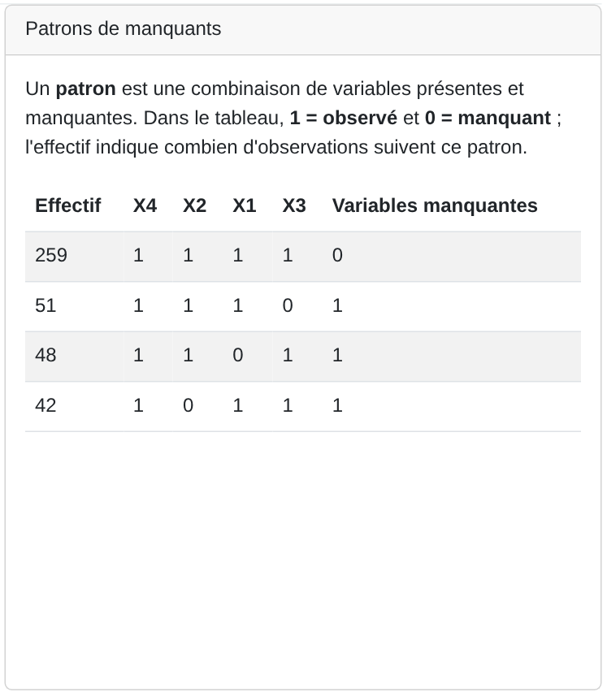
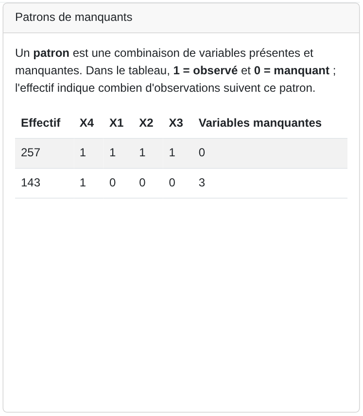
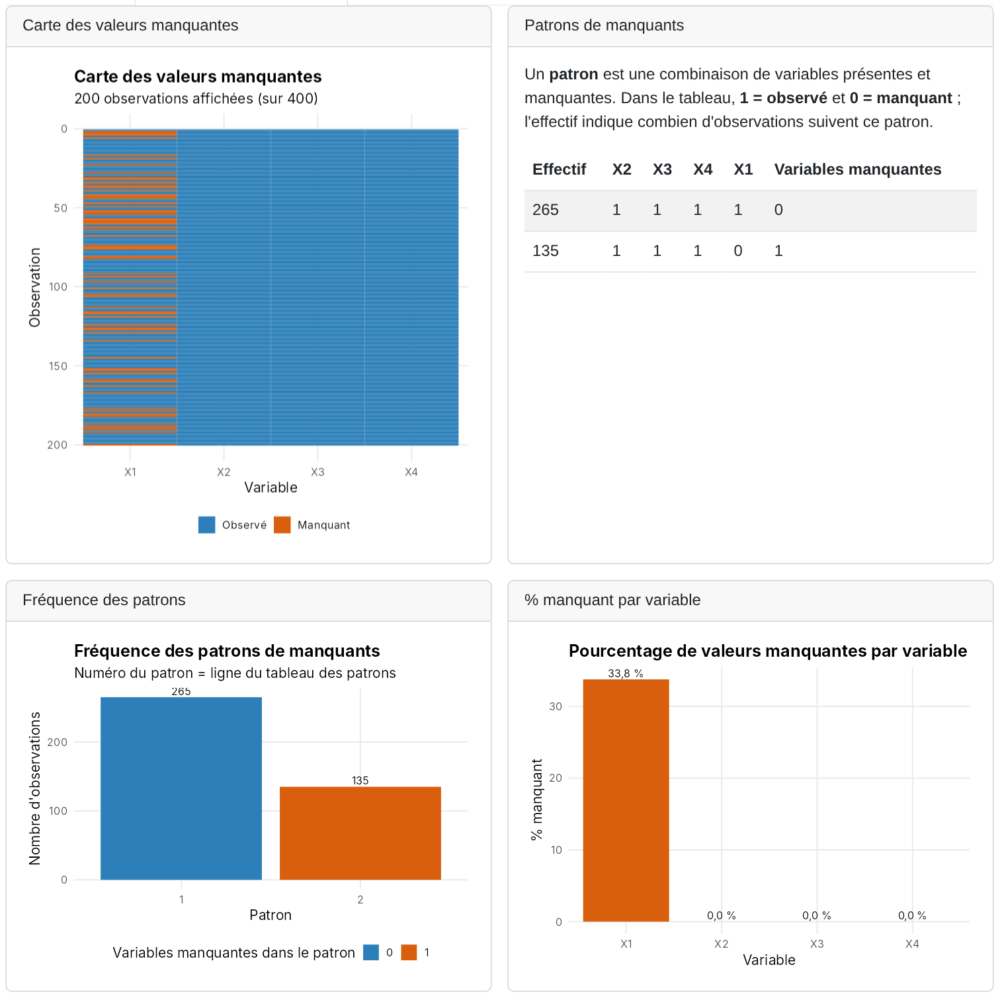
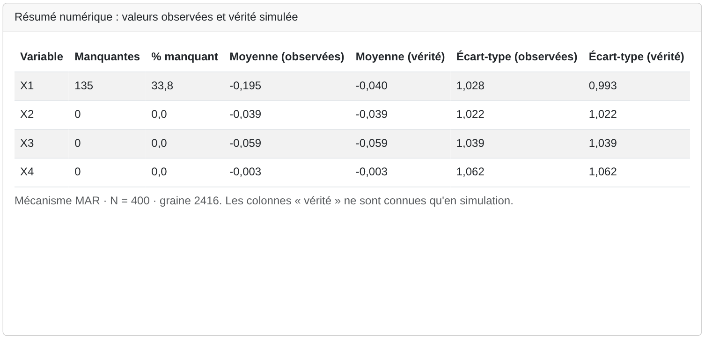
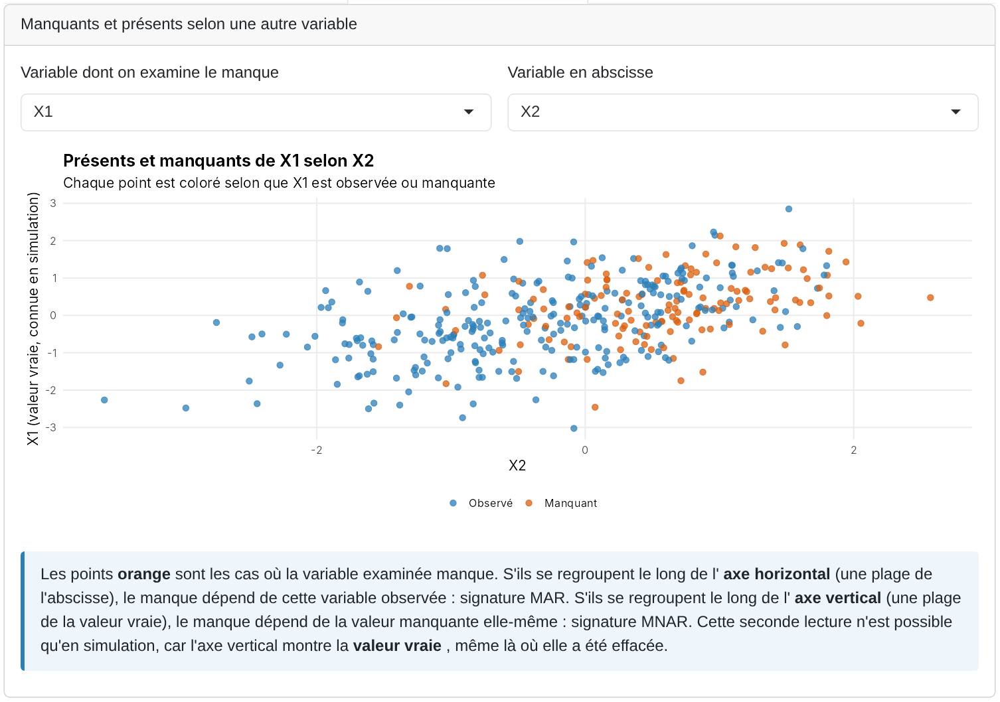
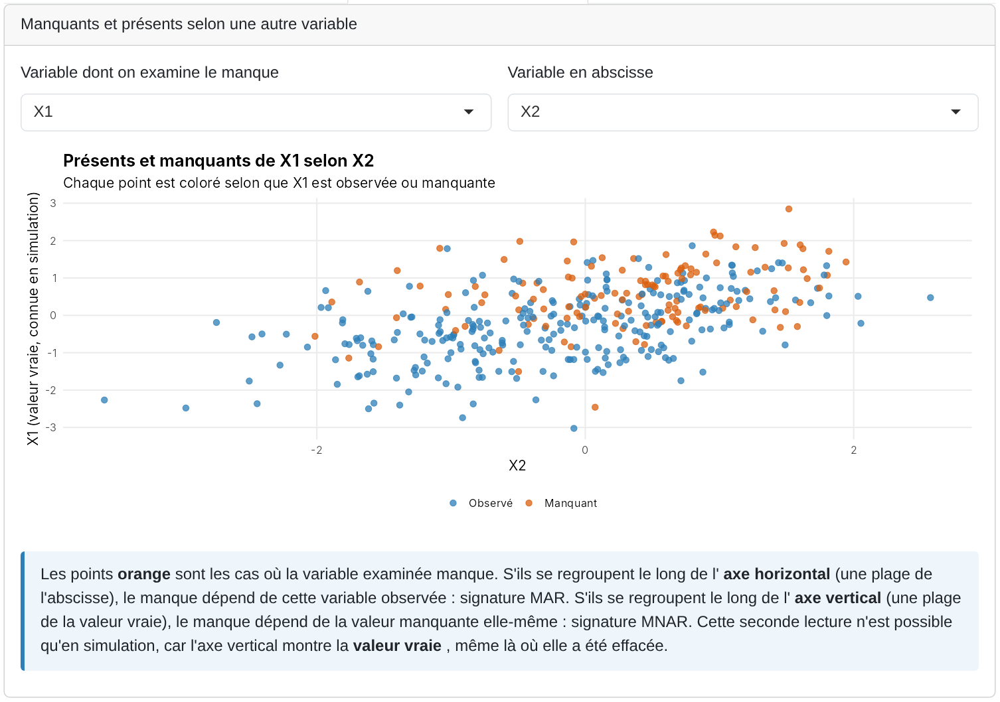

# Simuler et visualiser le manque {#sec-simuler-visualiser}

```{r}
#| include: false
source("_setup.R")
```

Avant de traiter des données manquantes, il faut savoir en *fabriquer* de façon
contrôlée — pour étudier les méthodes sur des cas dont on connaît la vérité — et
savoir en *décrire* la structure. Ce chapitre montre comment l'application produit
le manque selon un mécanisme choisi, puis en révèle la structure par quelques
visualisations essentielles. Il correspond à l'onglet **Données & visualisation**,
organisé en trois sous-onglets : **Données**, **Structure du manque** et
**Mécanisme et traitement**.

## Simuler des données complètes

On part de données sans aucun manque, tirées d'une loi normale multivariée : $p$
variables de moyenne 0 et d'écart-type 1, toutes corrélées entre elles au même
degré $\rho$. Ce jeu « complet » servira de **vérité de référence** : puisqu'on
connaît chaque valeur avant de l'effacer, on pourra plus tard mesurer exactement ce
qu'une méthode récupère ou déforme.

::: {.app}
**À l'application —** Onglet **Données & visualisation**, barre latérale
*Simulation*, volet **Structure** : réglez *Taille d'échantillon (N)*, *Nombre de
variables* et *Corrélation entre variables (ρ)*. Pour obtenir un tirage
reproductible, cochez *Fixer la graine (reproductible)* et saisissez une graine;
sinon, chaque clic sur *Simuler / rééchantillonner* tire une graine nouvelle, qui
s'affiche dans le champ *Graine aléatoire*. Reproduisez le **scénario de
référence** de la préface (graine 2416).
:::

## Amputer selon un mécanisme

Le @sec-mecanismes décrivait le manque « à la main » pour en révéler la logique. En
pratique, l'application automatise l'opération et gère les trois mécanismes : elle
choisit quelles cellules effacer selon que le manque doit être MCAR, MAR ou MNAR,
avec la probabilité logistique de la @fig-proba-manque.

::: {.callout-note}
L'application vise la proportion de **cas incomplets** — des lignes touchées par au
moins un manquant — et non le pourcentage de **cellules** manquantes. Ces deux
quantités diffèrent : surveillez toujours le pourcentage de cellules réellement
obtenu, affiché en tête de l'onglet.
:::

::: {.app}
**À l'application —** Dans la même barre latérale, volet **Manque** : choisissez le
*Mécanisme de manque* (*MCAR*, *MAR* ou *NMAR (MNAR)*) et faites glisser la
*Proportion de cas incomplets*. En tête de l'onglet, deux cartouches affichent les
*Cellules manquantes* et les *Cas incomplets*; dessous, l'encadré **Ce que vous avez
simulé** résume le mécanisme en une phrase.
:::

{#fig-cap-entete}

::: {.voir}
**Ce qu'on doit voir —** Les deux cartouches ne coïncident pas (@fig-cap-entete) :
la proportion de *cas incomplets* est supérieure au pourcentage de *cellules
manquantes*, puisqu'une seule cellule suffit à rendre toute une ligne incomplète.
Dans le scénario de référence, seule $X_1$ perd des valeurs : 135 lignes sur 400
sont incomplètes (33,8 %), mais ces 135 cellules ne représentent que
$135 / (400 \times 4) = 8{,}4\ \%$ du tableau.
:::

### Le bandeau « Réglages modifiés »

Les résultats de tous les onglets portent sur la **dernière simulation**. Si vous
changez un réglage de la barre latérale sans cliquer de nouveau sur *Simuler /
rééchantillonner*, un bandeau orangé le signale : les chiffres affichés
correspondent encore à l'ancien jeu (@fig-cap-perime). Ce bandeau réapparaît dans
les onglets **Traitements** et **Mécanisme du manque**.

{#fig-cap-perime width="85%"}

### Rendre le mécanisme visible — ou plus réaliste

Le **mode guidé** (case *Mode guidé : rendre le mécanisme visible*) offre deux
portées. La portée **Une seule** isole un mécanisme précis : on choisit quelle
variable devient manquante, et, sous MAR, quelle variable **observée** pilote cette
probabilité. C'est le meilleur point de départ pour comprendre MCAR, MAR et MNAR.
On règle aussi le **sens** : le manque frappe-t-il préférentiellement les valeurs
*élevées* du prédicteur, ou ses valeurs *faibles* ? Sous MNAR, la variable amputée
joue elle-même le rôle de prédicteur.

La portée **Plusieurs** sert à produire un questionnaire plus crédible. On
sélectionne alors les questions qui peuvent manquer et l'un de deux patrons :

- **réponses ponctuelles réparties** : les omissions touchent différentes questions,
  sans que chaque répondant perde nécessairement toutes les mêmes réponses ;
- **omission groupée d'un bloc** : certains répondants omettent toutes les questions
  sélectionnées, comme lorsqu'une section entière est sautée ou abandonnée.

Sous MAR multi-variables, le prédicteur est exclu des variables rendues manquantes.
Il demeure donc observé, condition nécessaire pour que l'exemple représente bien
l'hypothèse MAR. Enfin, si l'on décoche le mode guidé, l'application répartit le
manque entre toutes les variables selon un schéma standard (*mode diffus*), utile
pour explorer des patrons complexes, mais où le mécanisme se lit moins facilement.

::: {.app}
**À l'application —** Laissez coché *Mode guidé*. Sous *Portée du manque*,
commencez par *Une seule* : variable rendue manquante $X_1$, prédicteur $X_2$,
valeurs élevées vers manque — c'est le scénario de référence. Passez ensuite à
*Plusieurs*, cochez $X_1$, $X_2$ et $X_3$, simulez avec *Réponses ponctuelles
réparties*, puis avec *Omission groupée d'un bloc*, et comparez la carte *Patrons de
manquants* et la cartouche *Cellules manquantes*.
:::

::: {#fig-cap-multi layout-ncol=2}




Trois variables rendues manquantes ($X_1$, $X_2$, $X_3$), même proportion de cas incomplets (environ 35 %), deux patrons de non-réponse. La colonne $X_4$, prédicteur sous MAR, n'a jamais de valeur manquante.
:::

::: {.voir}
**Ce qu'on doit voir —** Avec des *réponses ponctuelles*, 141 lignes perdent une
seule valeur chacune, réparties entre $X_1$, $X_2$ et $X_3$ : environ 8,8 % de
cellules manquantes. Avec l'*omission d'un bloc*, 143 lignes perdent les trois
valeurs à la fois : environ 26,8 % de cellules manquantes, pour presque le même
nombre de cas incomplets (@fig-cap-multi).
:::

## Visualiser la structure du manque

Le sous-onglet **Structure du manque** rassemble quatre vues descriptives,
recalculées à chaque simulation (@fig-cap-structure).

{#fig-cap-structure}

### La carte des valeurs manquantes

La carte affiche, cellule par cellule, ce qui est observé (bleu) et ce qui manque
(orange) : chaque ligne du jeu est un trait, chaque variable une colonne. Au-delà de
200 observations, l'application en affiche 200 réparties régulièrement. On y repère
d'un coup d'œil les variables et les lignes les plus touchées, et l'on devine déjà
si le manque se concentre ou se disperse.

### Les patrons et leur fréquence

Un **patron** est une configuration distincte de présence/absence sur la ligne (par
exemple : $X_1$ manquante, le reste observé). Le tableau *Patrons de manquants* en
donne la liste, avec **1 = observé** et **0 = manquant**, l'effectif de chaque
patron et le nombre de variables manquantes qu'il comporte. Le graphique *Fréquence
des patrons* reprend les mêmes patrons, numérotés selon les lignes du tableau.

::: {.callout-tip}
Le tableau range les **colonnes** de la variable la moins touchée à la plus touchée,
et les **lignes** du patron complet aux patrons les plus troués. Ne cherchez donc pas
l'ordre $X_1, X_2, \ldots$ : lisez les noms en tête de colonne.
:::

La @fig-trois-patrons illustre les trois formes typiques. Un patron dominant
signale une structure simple (souvent univariée ou monotone) ; une multitude de
patrons rares signale un manque quelconque.

```{r}
#| label: fig-trois-patrons
#| fig-cap: "Trois structures de manque sur quatre variables (12 lignes montrées, orange = manquant). **Univarié** : une seule variable est touchée. **Monotone** : les variables s'ordonnent comme des vagues successives; dès qu'une valeur manque, toutes les suivantes manquent aussi, ce qui donne un escalier. **Quelconque** : les trous se répartissent sans ordre."
#| fig-width: 8.5
#| fig-height: 3.4
mk <- function(M, nom) data.frame(ligne = rep(seq_len(nrow(M)), ncol(M)),
  variable = rep(c("Vague 1", "Vague 2", "Vague 3", "Vague 4"), each = nrow(M)),
  manq = as.vector(M), type = nom)
U <- matrix(0, 12, 4); U[c(3, 5, 6, 9, 11), 4] <- 1
Mo <- matrix(0, 12, 4); Mo[7:12, 4] <- 1; Mo[9:12, 3] <- 1; Mo[11:12, 2] <- 1
set.seed(5); Q <- matrix(rbinom(48, 1, 0.22), 12, 4); Q[, 1][Q[, 1] == 1 & runif(12) < .5] <- 0
g <- rbind(mk(U, "Univarié"), mk(Mo, "Monotone"), mk(Q, "Quelconque"))
g$type <- factor(g$type, levels = c("Univarié", "Monotone", "Quelconque"))
ggplot(g, aes(variable, ligne, fill = factor(manq))) +
  geom_tile(colour = "white", linewidth = 0.6) +
  facet_wrap(~ type) + scale_y_reverse(breaks = NULL) +
  scale_fill_manual(values = c(`0` = COUL_OBS, `1` = COUL_NA), labels = c("Observé", "Manquant"), name = NULL) +
  labs(x = NULL, y = "Observations") +
  theme(axis.text.x = element_text(angle = 30, hjust = 1), panel.grid = element_blank())
```

### Le pourcentage par variable

La carte *% manquant par variable* classe les variables de la plus touchée à la
moins touchée. Sous un mécanisme piloté sur une seule variable, une colonne domine
nettement ; sous un mécanisme diffus, le manque se répartit plus également.

### Le résumé numérique

Le sous-onglet **Données** présente le jeu amputé (les cellules vides sont
manquantes) et un **résumé numérique** par variable : nombre et pourcentage de
manquants, moyenne et écart-type des valeurs observées, et, en regard, les mêmes
quantités calculées sur la vérité simulée (@fig-cap-resume).

{#fig-cap-resume}

Ce tableau donne une première mesure du **biais de sélection** : sous MAR, les
valeurs restantes de $X_1$ ne représentent plus l'ensemble. Les colonnes « vérité »
n'existent, bien sûr, qu'en simulation.

## Lire l'écran : décrire avant d'expliquer

Les quatre vues du sous-onglet **Structure du manque** répondent à des questions
différentes. Les confondre conduit vite à interpréter une simple description comme
une preuve de mécanisme.

| Sortie | Question descriptive | Lecture raisonnable | Ce qu'elle ne démontre pas |
|---|---|---|---|
| **Carte des valeurs manquantes** | Où sont les cellules absentes ? | Concentration par lignes, par variables ou par périodes. | Pourquoi elles manquent. |
| **Patrons de manquants** | Quelles combinaisons de variables sont absentes ensemble ? | Patron simple, emboîté ou multitude de combinaisons rares. | MCAR, MAR ou MNAR. |
| **Fréquence des patrons** | Quelle structure domine et combien de cas elle touche ? | Un patron fréquent peut guider un modèle ou une stratégie de collecte. | La validité d'une méthode d'imputation. |
| **% manquant par variable** | Quelles variables portent la plus grande part du problème ? | Prioriser l'examen de ces variables et de leurs prédicteurs possibles. | Le biais de l'analyse finale. |

: Les vues descriptives et leurs limites. {#tbl-vues-structure}

La bonne séquence est donc : **décrire** les cartes, **relier** leur forme au
processus de collecte, puis seulement **poser** une hypothèse de mécanisme. Une
concentration sur une variable peut être compatible avec MAR ou MNAR; elle ne les
départage pas.

## Rendre la sélectivité visible {#sec-selectivite}

La visualisation la plus instructive oppose le **prédicteur du manque** à la
variable amputée, en colorant les points selon qu'ils ont été rendus manquants ou
non. En simulation, on connaît la vraie valeur même là où elle a été effacée — on
peut donc placer *tous* les points, y compris ceux qui « manquent », ce qui serait
impossible sur de vraies données.

::: {.app}
**À l'application —** Sous-onglet **Mécanisme et traitement**, carte *Manquants et
présents selon une autre variable*. Choisissez *Variable dont on examine le manque*
= $X_1$ et *Variable en abscisse* = $X_2$. Faites ensuite l'expérience décisive :
gardez la même cible, passez le *Mécanisme de manque* de *MAR* à *NMAR (MNAR)* et
resimulez.
:::

::: {#fig-cap-selectivite layout-ncol=2}




La sélectivité du manque de $X_1$, même graine, deux mécanismes. L'axe vertical montre la valeur vraie de $X_1$, connue seulement en simulation.
:::

::: {.voir}
**Ce qu'on doit voir —** Sous **MAR**, les points orange (les manquants) se
regroupent le long de l'**axe horizontal**, vers la droite : le manque se décide
sur $X_2$, une variable observée. Sous **MNAR**, ils se regroupent le long de
l'**axe vertical**, vers le haut : le manque se décide sur $X_1$ elle-même —
précisément la valeur qui disparaît (@fig-cap-selectivite). Comme $X_1$ et $X_2$
sont corrélées, chaque nuage garde aussi une trace oblique; c'est la direction
dominante qui compte. Sur des données réelles, l'axe vertical « valeur vraie »
n'existe pas : seule la première lecture reste possible.
:::

::: {.callout-tip}
Le sous-onglet **Mécanisme et traitement** propose aussi *Effet d'une imputation sur
la distribution* : on y verra, dès le @sec-cas-complets, comment l'imputation par la
moyenne resserre la distribution autour de son centre.
:::

## Exercices {.unnumbered}

**3.1** *(Données & visualisation.)* En mode guidé, réglez le *Sens du mécanisme*
sur *Valeurs faibles vers manque*, resimulez et examinez le nuage de sélectivité.
Où se déplacent les points manquants — à droite ou à gauche ? Comment la moyenne
des valeurs observées de $X_1$ se compare-t-elle maintenant à la vérité, dans le
résumé numérique ? *(Solution : @sec-sol-simuler.)*

**3.2** *(Données & visualisation.)* Toujours en mode guidé, choisissez le mécanisme
*NMAR (MNAR)* pour $X_1$ et observez le nuage $X_2$ contre $X_1$. Le regroupement
des points orange suit-il plutôt l'axe horizontal ou l'axe vertical ? Interprétez en
termes de la variable — observée ou manquante — qui gouverne le manque.

**3.3** L'attrition d'un suivi longitudinal produit un patron **monotone** : dès
qu'un participant décroche, il manque à toutes les vagues suivantes. Dans le tableau
*Patrons de manquants*, à quoi reconnaîtrait-on un tel patron, par opposition à un
manque *quelconque* ? Appuyez-vous sur la @fig-trois-patrons.

**3.4** *(Données & visualisation.)* À proportion de cas incomplets fixée, choisissez
trois variables avec la portée *Plusieurs*. Comparez les pourcentages de *cellules
manquantes* et les patrons obtenus avec *Réponses ponctuelles réparties* puis avec
*Omission groupée d'un bloc*. Lequel produit les lignes les plus incomplètes, et
pourquoi le pourcentage de cellules est-il environ trois fois plus grand ?
