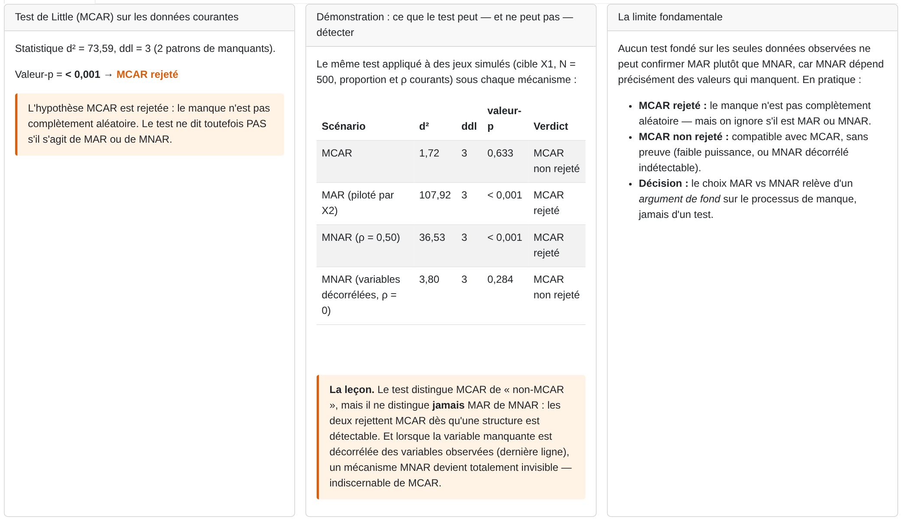
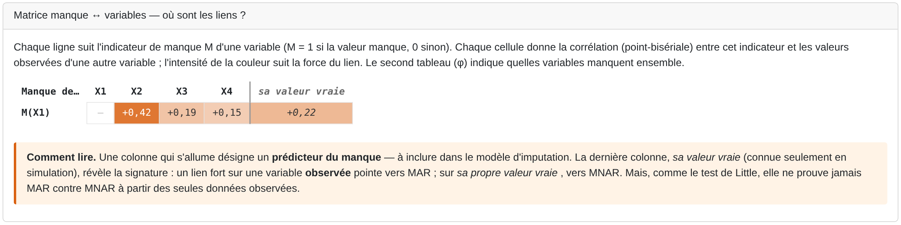

# Diagnostic : le test de Little {#sec-diagnostic-little}

```{r}
#| include: false
source("_setup.R")
source("_moteur.R")
cp  <- simuler_complet(400, 4, 0.5, graine = 2416L)
amp <- amputer(cp, 0.35, "MAR", 2416L, var_cible = "X1", var_pilote = "X2")$amp
```

Peut-on savoir, à partir des données, quel mécanisme a produit le manque ? La
réponse est nuancée et instructive : on peut tester l'hypothèse MCAR, mais on ne
peut **jamais** distinguer MAR de MNAR sur les seules données observées. Ce chapitre
présente le test de Little [-@little1988], son principe, un calcul détaillé et sa
limite fondamentale. Il correspond au sous-onglet **Diagnostic** de l'onglet
**Mécanisme du manque**.

## Peut-on tester le mécanisme ?

Rappelons la hiérarchie du @sec-mecanismes. Sous MCAR, le manque ne dépend de rien ;
sous MAR, il dépend de l'observé ; sous MNAR, du manquant. La première frontière —
MCAR contre le reste — laisse une trace détectable : si le manque dépend des
variables observées, alors les cas complets et les cas incomplets diffèrent sur ces
variables. C'est précisément ce que le test de Little exploite.

## Le test de Little

L'idée est la suivante. Si les données sont MCAR, alors, quel que soit le patron de
manque, la moyenne des variables observées devrait être la même d'un patron à
l'autre (aux fluctuations d'échantillonnage près). Le test compare donc les moyennes
observées de chaque patron à une estimation d'ensemble, et agrège les écarts en une
statistique du khi-carré.

Notons $j = 1, \ldots, J$ les patrons, $n_j$ le nombre de lignes du patron $j$,
$\bar{\mathbf{x}}_j$ le vecteur des moyennes des variables **observées** dans ce
patron, et $\hat{\boldsymbol\mu}_j$, $\hat{\boldsymbol\Sigma}_j$ les parties
correspondantes de la moyenne et de la covariance d'ensemble. La statistique est

$$
d^2 = \sum_{j=1}^{J} n_j\,
(\bar{\mathbf{x}}_j - \hat{\boldsymbol\mu}_j)^{\top}\,
\hat{\boldsymbol\Sigma}_j^{-1}\,
(\bar{\mathbf{x}}_j - \hat{\boldsymbol\mu}_j).
$$

Chaque terme est une distance standardisée entre ce que l'on observe dans un patron
et ce que l'on attendrait si le patron était un sous-échantillon pris au hasard,
pondérée par la taille du patron. Sous $H_0$ (MCAR), $d^2$ suit approximativement
une loi $\chi^2$ dont le nombre de degrés de liberté vaut $\left(\sum_j p_j\right) - p$,
où $p_j$ est le nombre de variables observées dans le patron $j$ et $p$ le nombre
total de variables.

Le calcul comporte deux temps. D'abord, estimer $\hat{\boldsymbol\mu}$ et
$\hat{\boldsymbol\Sigma}$ malgré les trous : l'**algorithme EM** comble
provisoirement les manquants par leurs valeurs attendues compte tenu de l'observé,
réestime la moyenne et la covariance, et répète jusqu'à stabilité. Ensuite, mesurer
patron par patron l'écart entre les moyennes observées et cette estimation, et le
cumuler en $d^2$.

## Un calcul complet sur le scénario de référence

Dans le scénario de référence, il n'y a que deux patrons : les 265 lignes complètes,
et les 135 lignes où $X_1$ manque. Le @tbl-little-calcul détaille le calcul.

```{r}
#| label: tbl-little-calcul
#| tbl-cap: "Décomposition du test de Little sur le scénario de référence (MAR, $X_1$ amputée selon $X_2$). Pour chaque patron, la moyenne observée de $X_2$ est comparée à son estimation EM d'ensemble; la dernière colonne donne la contribution du patron à $d^2$, calculée sur toutes ses variables observées."
X <- as.matrix(amp); em <- em_mvn(X); M <- is.na(X)
key <- apply(M, 1, function(r) paste(as.integer(!r), collapse = ""))
rows <- lapply(unique(key), function(k) {
  idx <- which(key == k); obs <- !M[idx[1], ]
  xb <- colMeans(X[idx, obs, drop = FALSE]); d <- xb - em$mu[obs]
  c2 <- length(idx) * as.numeric(t(d) %*% solve(em$sigma[obs, obs]) %*% d)
  data.frame(Patron = if (all(obs)) "Complet" else "X1 manquante",
             `n_j` = length(idx), `p_j` = sum(obs),
             `Moyenne de X2 (patron)` = frn(xb["X2"], 3),
             `Moyenne de X2 (EM)` = frn(em$mu["X2"], 3),
             `Contribution à d²` = frn(c2, 2), check.names = FALSE)
})
tab <- do.call(rbind, rows)
t <- little_mcar_test(amp)
tab <- rbind(tab, data.frame(Patron = "Total", n_j = sum(tab$n_j), p_j = sum(tab$p_j),
  `Moyenne de X2 (patron)` = "", `Moyenne de X2 (EM)` = "",
  `Contribution à d²` = frn(t$statistic, 2), check.names = FALSE))
knitr::kable(tab, align = "lrrrrr")
```

La lecture est directe. Dans les lignes complètes, $X_2$ vaut en moyenne
`r frn(colMeans(amp[complete.cases(amp), ])["X2"], 3)`; dans les lignes où $X_1$
manque, `r frn(colMeans(amp[!complete.cases(amp), ])["X2"], 3)`. Sous MCAR, ces deux
moyennes devraient être proches l'une de l'autre et de l'estimation d'ensemble
(`r frn(em$mu["X2"], 3)`). Leur écart, multiplié par la taille des patrons et
standardisé, donne $d^2 = `r frn(t$statistic, 2)`$. Les degrés de liberté valent
$(4 + 3) - 4 = 3$, et la probabilité d'un $\chi^2_3$ aussi grand est inférieure à
0,001 : MCAR est rejeté. Le test a détecté ce qu'on avait construit : le manque de
$X_1$ dépend de $X_2$.

::: {.app}
**À l'application —** Onglet **Mécanisme du manque**, sous-onglet **Diagnostic**,
carte *Test de Little (MCAR) sur les données courantes*. Avec le scénario de
référence, lisez la statistique $d^2$, les degrés de liberté et la valeur-p.
Basculez ensuite le mécanisme sur MCAR dans *Données & visualisation*, resimulez,
et revenez lire le test.
:::

{#fig-cap-diag}

::: {.voir}
**Ce qu'on doit voir —** Sous un manque MAR piloté de façon nette, la valeur-p est
très petite et le verdict affiche « MCAR rejeté » (@fig-cap-diag) — attendu,
puisque le manque est conditionné par une variable observée. Sous MCAR, le test ne
devrait rejeter qu'environ une fois sur vingt, au seuil de 5 %; un tirage isolé peut
donc toujours produire un faux rejet.
:::

### Conditions de lecture du test

Le test de Little est une approximation fondée sur un modèle multinormal et sur une
approximation du khi-carré. Il est plus fragile lorsque l'échantillon est petit, que
les distributions sont très asymétriques ou catégorielles, ou que de nombreux
patrons rares fragmentent les données. Dans ces situations, une valeur-p ne doit
jamais être traitée comme un verdict mécanique : on l'interprète avec la carte du
manque, la connaissance de la collecte et la taille effective de chaque patron.

## Ce que le test détecte — et ce qu'il ne détecte pas

Un seul jeu de données ne prouve rien : sous MCAR, le test rejette à tort dans une
proportion de cas égale au seuil $\alpha$. Pour cerner son comportement, il faut
mesurer le **taux de rejet** sur de nombreuses réplications, sous chaque mécanisme.
La @fig-little-puissance le fait pour le scénario de référence, en faisant varier la
corrélation $\rho$ entre les variables.

```{r}
#| label: fig-little-puissance
#| fig-cap: "Taux de rejet de MCAR par le test de Little (seuil de 5 %), sur 200 jeux simulés par point : N = 400, quatre variables, 35 % de cas incomplets, $X_1$ amputée. Sous MCAR, le taux reste près de 5 %, comme il se doit. Sous MAR (piloté par $X_2$), le test rejette toujours : $X_2$ diffère directement d'un patron à l'autre. Sous MNAR, la puissance dépend entièrement de la corrélation : quand les variables sont indépendantes ($\\rho = 0$), un MNAR ne laisse aucune trace dans l'observé et le test ne le voit pas plus qu'un MCAR."
#| fig-width: 7
#| fig-height: 4
#| cache: true
rhos <- c(0, 0.1, 0.2, 0.3, 0.5, 0.7)
res <- expand.grid(rho = rhos, meca = c("MCAR", "MAR", "MNAR"), stringsAsFactors = FALSE)
res$taux <- mapply(function(r, m) {
  mean(vapply(1:200, function(k) {
    g <- 50000L + k
    d <- simuler_complet(400, 4, r, graine = g)
    a <- amputer(d, 0.35, m, g, var_cible = "X1", var_pilote = if (m == "MAR") "X2" else NULL)$amp
    little_mcar_test(a)$p.value < 0.05
  }, logical(1)))
}, res$rho, res$meca)
res$meca <- factor(res$meca, levels = c("MCAR", "MAR", "MNAR"))
ggplot(res, aes(rho, 100 * taux, colour = meca)) +
  geom_hline(yintercept = 5, linetype = "dashed", colour = GRIS) +
  geom_line(linewidth = 1) + geom_point(size = 2.3) +
  annotate("text", x = 0.7, y = 9, label = "seuil de 5 %", hjust = 1, colour = GRIS, size = 3.5) +
  scale_colour_manual(values = c(MCAR = GRIS, MAR = COUL_OBS, MNAR = COUL_NA), name = NULL) +
  scale_y_continuous(labels = pct_axe, limits = c(0, 100)) + sx_fr(breaks = rhos) +
  labs(x = expression("Corrélation entre les variables " * rho), y = "Taux de rejet de MCAR")
```

Quatre leçons s'en dégagent :

- **MCAR** : le test rejette environ 5 % du temps — le taux d'erreur nominal. Il se
  comporte correctement.
- **MAR** : le manque dépend de $X_2$, qui est observée; ses moyennes diffèrent donc
  directement d'un patron à l'autre, et le test rejette presque toujours, **quelle que
  soit** la corrélation.
- **MNAR** avec des variables corrélées : le test rejette lui aussi — mais
  **indirectement**, parce que la variable amputée est corrélée à des variables
  observées qui trahissent la sélection.
- **MNAR** avec des variables indépendantes ($\rho = 0$) : le test rejette environ
  5 % du temps, comme sous MCAR. Le mécanisme non aléatoire devient **invisible**.

::: {.app}
**À l'application —** Carte *Démonstration : ce que le test peut — et ne peut pas —
détecter*. Elle applique le test à quatre jeux simulés de 500 lignes — MCAR, MAR
(piloté par $X_2$), MNAR, et MNAR à variables décorrélées ($\rho = 0$). Faites
varier la *Corrélation entre variables (ρ)* dans *Données & visualisation*,
resimulez, et revenez lire la démonstration.
:::

::: {.voir}
**Ce qu'on doit voir —** Avec le scénario de référence ($\rho = 0{,}5$), MAR et MNAR
aboutissent tous deux à « MCAR rejeté » : le test **ne les départage pas**. La ligne
*MNAR à variables décorrélées* affiche « MCAR non rejeté » ($p = 0{,}284$) — un
mécanisme non aléatoire devient **invisible** dès qu'il ne laisse aucune trace dans
l'observé. Ramenez $\rho$ vers 0 et voyez la ligne MNAR ordinaire rejoindre ce sort.
Chaque ligne est un seul tirage : pour un taux de rejet, il faut la
@fig-little-puissance.
:::

## La matrice manque ↔ variables

Le test de Little donne un verdict global. La carte *Matrice manque ↔ variables*
détaille **où** se trouvent les liens. Chaque ligne suit l'indicateur de manque
$M$ d'une variable (1 si la valeur manque, 0 sinon); chaque cellule donne sa
corrélation avec les valeurs observées d'une autre variable. Un second tableau
($\varphi$) indique, lorsque plusieurs variables sont incomplètes, lesquelles
manquent ensemble.

{#fig-cap-matrice}

Une colonne qui s'allume désigne un **prédicteur du manque** — une variable à
inclure dans le modèle d'imputation. Sur de vraies données, la dernière colonne
n'existe pas; la matrice ne prouve donc jamais MAR contre MNAR. Elle sert à
**choisir** les variables auxiliaires, non à établir le mécanisme.

## Lire l'écran : trois sorties, trois rôles

Le sous-onglet **Diagnostic** juxtapose volontairement trois objets. Ils ne se
remplacent pas; chacun répond à une question plus étroite que la précédente.

| Sortie | Ce qu'il faut relever | Interprétation permise | Limite décisive |
|---|---|---|---|
| **Test de Little** | statistique, degrés de liberté, valeur-p | Une petite valeur-p est incompatible avec MCAR dans ce modèle. | Il ne choisit pas entre MAR et MNAR; un grand *p* ne prouve pas MCAR. |
| **Démonstration** | verdict sous plusieurs mécanismes simulés | La détectabilité dépend de la corrélation et de la structure du manque. | C'est une leçon sur une simulation, non une analyse supplémentaire de votre jeu. |
| **Matrice manque ↔ variables** | lignes et colonnes qui « s'allument » | Des variables observées associées au manque sont de bonnes candidates au modèle d'imputation. | Une association n'établit ni causalité ni MAR. |

: Les trois sorties du diagnostic. {#tbl-sorties-diag}

Après ce sous-onglet, l'action raisonnable n'est donc pas « choisir MAR ». C'est de
réunir les variables observées liées au manque, de vérifier si elles étaient mesurées
pour tous, puis de les inclure au modèle d'imputation avec les variables de
l'analyse.

## La limite fondamentale

::: {.callout-warning}
Le test de Little départage MCAR du reste. Il ne distingue **jamais** MAR de MNAR :
les deux rejettent MCAR dès qu'une structure est détectable, et aucun test fondé sur
les seules données observées ne peut aller plus loin — car MNAR dépend précisément de
ce qui n'est pas observé.
:::

Deux conclusions pratiques en découlent :

- un **rejet** de MCAR indique que le manque n'est pas complètement aléatoire, sans
  dire s'il est MAR ou MNAR ;
- un **non-rejet** est compatible avec MCAR, sans le prouver : il peut refléter une
  faible puissance, ou un MNAR décorrélé indétectable.

Le choix entre MAR et MNAR relève donc d'un **argument de fond** sur le processus de
manque, jamais d'un test. Lorsque le doute d'un mécanisme MNAR subsiste, on en
encadre la conséquence par l'analyse de sensibilité (@sec-sensibilite-mnar).

## Exercices {.unnumbered}

**4.1** *(Diagnostic.)* Réglez un mécanisme **MCAR** dans *Données & visualisation*,
puis lisez la carte *Test de Little* : la valeur-p est-elle grande ? Resimulez sans
fixer la graine, une dizaine de fois. Le verdict « MCAR non rejeté » tient-il à
chaque fois ? Qu'en concluez-vous sur le sens d'un test unique ?
*(Solution : @sec-sol-diagnostic.)*

**4.2** *(Diagnostic.)* Sur la carte *Démonstration*, sous la ligne **MNAR**, faites
varier la *Corrélation entre variables (ρ)* de 0 à 0,8 en resimulant à chaque
palier. À partir de quelle corrélation la ligne passe-t-elle de « non rejeté » à
« rejeté » ? Comparez avec la @fig-little-puissance et expliquez pourquoi une
corrélation plus forte rend le MNAR détectable.

**4.3** Pourquoi un non-rejet de MCAR ne permet-il pas de conclure que l'imputation
multiple sera valide ? Reliez votre réponse à la notion d'ignorabilité (@sec-mecanismes).

**4.4** Dans le @tbl-little-calcul, le patron « X1 manquante » contribue davantage à
$d^2$ que le patron complet, alors qu'il compte moitié moins de lignes. Pourquoi ?
*(Indice : comparez l'écart entre la moyenne de $X_2$ du patron et sa moyenne EM.)*
