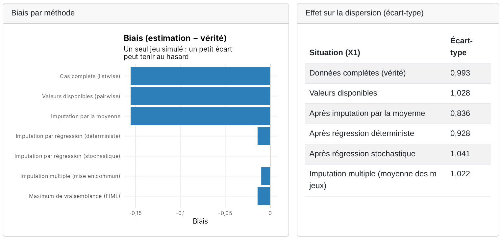
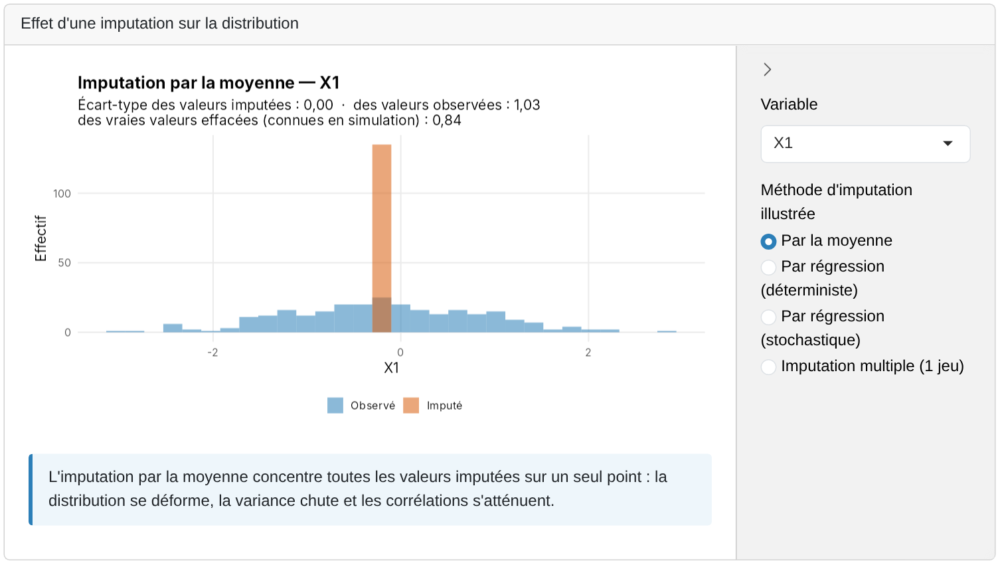
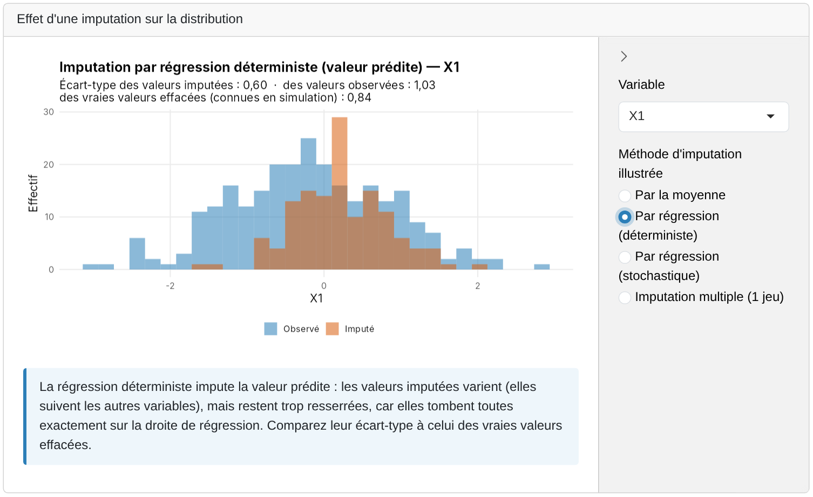
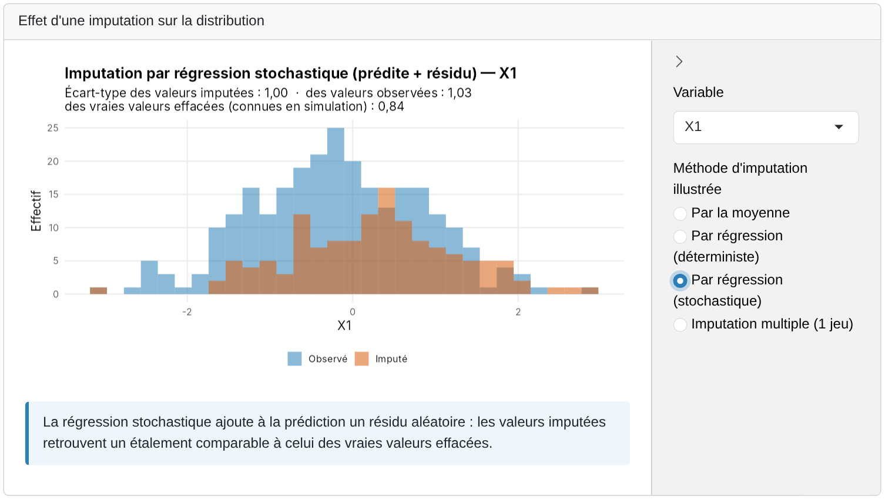
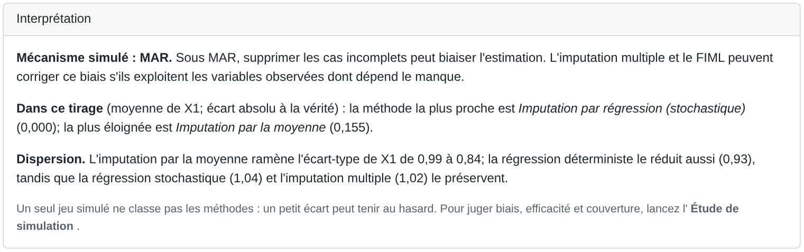

# Cas complets et imputation simple {#sec-cas-complets}

```{r}
#| include: false
source("_setup.R")
source("_moteur.R")
cp  <- simuler_complet(400, 4, 0.5, graine = 2416L)
amp <- amputer(cp, 0.35, "MAR", 2416L, var_cible = "X1", var_pilote = "X2")$amp
```

Face à un jeu incomplet, les premières idées qui viennent — supprimer les lignes
incomplètes, ou boucher les trous par une valeur unique — sont aussi les plus
trompeuses. Ce chapitre examine l'analyse des cas complets et les imputations
simples, et met au jour leurs pathologies. Il correspond à l'onglet **Traitements**
de l'application et à la carte *Effet d'une imputation sur la distribution* de
l'onglet **Données & visualisation**.

Tout au long du chapitre, on raisonne sur le scénario de référence : le manque de
$X_1$ dépend de la variable observée $X_2$ (mécanisme MAR). Puisqu'on simule les
données, on connaît la **vérité de référence** — vraie moyenne, vrai écart-type,
vraie corrélation de $X_1$ — et l'on peut donc mesurer exactement ce que chaque
méthode conserve ou déforme.

## L'analyse des cas complets

L'analyse des **cas complets** (ou *listwise*) supprime toute ligne comportant au
moins un manquant. Simple et automatique — c'est le comportement par défaut de la
plupart des logiciels —, elle est généralement sans biais sous MCAR, mais elle perd
de l'information. Sous MAR, elle peut être biaisée parce que les cas restants ne
représentent plus la population; l'ampleur et même l'existence du biais dépendent
toutefois de la quantité visée et du modèle d'analyse.

Le manque de $X_1$ étant lié à $X_2$, la moyenne des cas complets est nettement
biaisée : elle vaut −0,195 alors que la vraie moyenne est −0,040. À ce biais
s'ajoute une **perte d'efficacité** : on a jeté toute l'information des lignes
incomplètes, y compris leurs valeurs observées de $X_2$, $X_3$ et $X_4$.

### Une moyenne biaisée, une pente intacte {#sec-cc-regression}

Le biais des cas complets dépend de la **question posée**. La @fig-cc-regression
compare deux sélections sur le même nuage : dans la première, $X_1$ manque selon
$X_2$ (MAR); dans la seconde, selon $X_1$ elle-même (MNAR).

```{r}
#| label: fig-cc-regression
#| fig-cap: "Régression de $X_1$ sur $X_2$ (2 000 observations, environ 35 % de $X_1$ manquantes). Trait vert : droite sur les données complètes; trait bleu : droite sur les seuls cas complets. À gauche, le manque dépend de $X_2$, le prédicteur : on retire surtout des points à droite, mais ceux qui restent suivent la même droite, dont la pente est préservée (0,49 contre 0,49). À droite, le manque dépend de $X_1$, la variable expliquée : on coupe le haut du nuage, ce qui aplatit la droite (0,34 contre 0,49). Dans les deux cas, la moyenne de $X_1$ des cas complets est trop basse."
#| fig-width: 9
#| fig-height: 4
d <- sim_mvn(2000, p = 2, rho = 0.5, graine = 31); set.seed(32)
sel <- list(`Le manque dépend de X2 (prédicteur)` = runif(2000) < p_manque(d$X2, 3),
            `Le manque dépend de X1 (variable expliquée)` = runif(2000) < p_manque(d$X1, 3))
g <- do.call(rbind, lapply(names(sel), function(k)
  data.frame(cas = k, X1 = d$X1, X2 = d$X2, statut = ifelse(sel[[k]], "Manquant", "Observé"))))
g$cas <- factor(g$cas, levels = names(sel))
pent <- do.call(rbind, lapply(names(sel), function(k) {
  b0 <- coef(lm(X1 ~ X2, d)); b1 <- coef(lm(X1 ~ X2, d[!sel[[k]], ]))
  data.frame(cas = k, a0 = b0[1], s0 = b0[2], a1 = b1[1], s1 = b1[2],
             lab = sprintf("pente complète : %s\npente des cas complets : %s", frn(b0[2]), frn(b1[2])))
}))
pent$cas <- factor(pent$cas, levels = names(sel))
ggplot(g, aes(X2, X1)) +
  geom_point(aes(colour = statut), size = 0.7, alpha = 0.45) +
  geom_abline(data = pent, aes(intercept = a0, slope = s0), colour = COUL_ACC, linewidth = 1.1, linetype = "dashed") +
  geom_abline(data = pent, aes(intercept = a1, slope = s1), colour = COUL_OBS, linewidth = 1.1) +
  geom_text(data = pent, aes(x = -3.3, y = 3.4, label = lab), hjust = 0, vjust = 1, size = 3.3) +
  facet_wrap(~ cas) +
  scale_colour_manual(values = c(Observé = "#9ecae1", Manquant = "#fdae6b"), name = NULL) +
  guides(colour = guide_legend(override.aes = list(size = 3, alpha = 1))) +
  coord_cartesian(xlim = c(-3.3, 3.3), ylim = c(-3.5, 3.5)) + sx_fr() + sy_fr() +
  labs(x = expression(X[2]), y = expression(X[1]))
```

La raison est simple : une régression décrit $X_1$ **à valeur donnée de $X_2$**. Si
le manque ne dépend que de $X_2$, les lignes restantes ont, pour chaque valeur de
$X_2$, la même distribution de $X_1$ que les lignes perdues; la droite ne bouge pas.
La moyenne marginale de $X_1$, elle, ignore $X_2$ et subit la sélection de plein
fouet. Retenez donc : **sous MAR, les cas complets peuvent être sans biais pour une
régression dont les prédicteurs contiennent la cause du manque, tout en étant
biaisés pour une moyenne.**

## Les paires disponibles

L'analyse des **paires disponibles** (*pairwise*) calcule chaque statistique sur le
maximum d'observations disponibles pour les variables concernées : une corrélation
entre deux variables utilise toutes les lignes où *ces deux-là* sont présentes,
même si d'autres colonnes y manquent. Elle exploite ainsi plus d'information que le
listwise, mais peut produire des matrices de covariance **incohérentes** (non
définies positives), car chaque coefficient repose sur un sous-échantillon
différent. Dans le scénario de référence, seule $X_1$ est incomplète : paires
disponibles et cas complets donnent donc exactement les mêmes résultats.

## L'imputation par la moyenne

L'imputation par la moyenne remplace chaque valeur manquante par la moyenne des
valeurs observées. Elle est séduisante mais cumule **trois défauts**. Comparée à la
vérité de référence, elle :

1. **ne corrige pas le biais** : la moyenne complétée reste celle des cas observés ;
2. **rétrécit la variance** : les valeurs imputées s'empilent toutes sur un même
   point, le centre ;
3. **atténue les corrélations** vers zéro : les valeurs imputées ne covarient plus
   avec les autres variables.

::: {.app}
**À l'application —** Onglet **Traitements**, *Quantité à estimer* = **Moyenne d'une
variable**, variable $X_1$, puis *Comparer les méthodes*. Lisez le tableau
*Comparaison des estimations*, le graphique *Biais par méthode* et le tableau *Effet
sur la dispersion (écart-type)*.
:::

{#fig-cap-trait-moyenne}

{#fig-cap-trait-biais}

::: {.voir}
**Ce qu'on doit voir —** Les lignes *Cas complets (listwise)* et *Imputation par la
moyenne* affichent le **même** biais sur la moyenne, −0,155 : boucher les trous par
la moyenne ne corrige rien (@fig-cap-trait-moyenne). Dans le tableau de dispersion,
l'imputation par la moyenne **rétrécit** l'écart-type de 0,993 à 0,836 (@fig-cap-trait-biais) — les valeurs imputées se sont empilées au centre.
:::

Le rétrécissement se calcule. Si une proportion $q$ des valeurs est remplacée par la
moyenne observée, la variance après imputation vaut à peu près $(1-q)$ fois la
variance observée. Avec $q = 0{,}338$ et un écart-type observé de 1,028, on attend
$1{,}028 \times \sqrt{0{,}662} \approx 0{,}836$ : c'est exactement ce qu'affiche
l'application.

## L'imputation par régression

Plutôt qu'une constante, on peut prédire chaque valeur manquante par une régression
sur les autres variables. Deux variantes s'opposent; la @fig-imput-simples les met
côte à côte.

L'imputation **déterministe** utilise la prédiction telle quelle. Elle corrige le
biais de la moyenne, mais place toutes les valeurs imputées **exactement** sur la
surface de régression : la variance résiduelle est absente. L'écart-type reste trop
petit, et la corrélation avec $X_2$ se trouve **gonflée** au-delà de sa valeur
réelle.

L'imputation **stochastique** ajoute à chaque prédiction un résidu aléatoire, de
variance égale à la variance résiduelle estimée. Cette fois, l'écart-type et la
corrélation retrouvent des valeurs proches de la vérité : ajouter le bruit résiduel
rend aux valeurs imputées la dispersion qu'une vraie observation aurait eue autour
de la droite de régression.

```{r}
#| label: fig-imput-simples
#| fig-cap: "Le scénario de référence, quatre façons de traiter les 135 valeurs manquantes de $X_1$ (en orange). **Vérité** : les valeurs effacées, à leur vraie place. **Moyenne** : toutes sur une ligne horizontale, sans lien avec $X_2$. **Régression déterministe** : toutes sur une droite, sans dispersion. **Régression stochastique** : autour de la droite, avec une dispersion réaliste. La corrélation entre $X_1$ et $X_2$ est indiquée dans chaque panneau (vérité : 0,50)."
#| fig-width: 9
#| fig-height: 3.4
manq <- is.na(amp$X1)
x1 <- list(`Vérité` = cp$X1,
           `Moyenne` = ifelse(manq, mean(amp$X1, na.rm = TRUE), amp$X1),
           `Régression déterministe` = imputer_regression(amp, "deterministe", 2416L)$X1,
           `Régression stochastique` = imputer_regression(amp, "stochastique", 2416L)$X1)
g <- do.call(rbind, lapply(names(x1), function(k)
  data.frame(meth = k, X2 = cp$X2, X1 = x1[[k]], statut = ifelse(manq, "Manquant / imputé", "Observé"))))
g$meth <- factor(g$meth, levels = names(x1))
lab <- data.frame(meth = factor(names(x1), levels = names(x1)),
                  r = sapply(x1, function(v) paste0("r = ", frn(cor(v, cp$X2)))))
ggplot(g, aes(X2, X1, colour = statut)) +
  geom_point(size = 0.8, alpha = 0.7) +
  geom_text(data = lab, aes(x = -2.9, y = 3.1, label = r), inherit.aes = FALSE, hjust = 0, size = 3.4) +
  facet_wrap(~ meth, nrow = 1) +
  scale_colour_manual(values = c(Observé = "#9ecae1", `Manquant / imputé` = COUL_NA), name = NULL) +
  guides(colour = guide_legend(override.aes = list(size = 3))) +
  coord_cartesian(xlim = c(-3, 3), ylim = c(-3.2, 3.2)) + sx_fr() + sy_fr() +
  labs(x = expression(X[2]), y = expression(X[1]))
```

::: {.app}
**À l'application —** Onglet **Données & visualisation**, sous-onglet **Mécanisme et
traitement**, carte *Effet d'une imputation sur la distribution*. Pour la variable
$X_1$, comparez les *Méthodes d'imputation illustrées* **Par la moyenne**, **Par
régression (déterministe)** et **Par régression (stochastique)**. Le sous-titre du
graphique donne l'écart-type des valeurs imputées, celui des valeurs observées et
celui des vraies valeurs effacées.
:::

::: {#fig-cap-imput layout-ncol=3}






Les valeurs imputées de $X_1$ (orange) superposées aux valeurs observées (bleu). L'écart-type des vraies valeurs effacées, connu en simulation, vaut 0,84.
:::

::: {.voir}
**Ce qu'on doit voir —** *Par la moyenne*, la distribution imputée forme un **pic**
au centre : toute la variabilité a disparu. *Par régression (déterministe)*, les
valeurs imputées se dispersent, mais deux fois moins que les vraies valeurs
effacées (0,60 contre 0,84). *Par régression (stochastique)*, elles retrouvent un
étalement comparable (@fig-cap-imput) — le bruit résiduel rétablit la dispersion.
Ici, l'étalement est même un peu plus grand que celui des valeurs effacées : un seul
tirage aléatoire fluctue.
:::

::: {.callout-tip}
L'imputation stochastique par régression est le bon **ingrédient** ; il lui manque
encore un élément. En imputant une seule fois, on traite les valeurs imputées comme
si elles étaient certaines — alors qu'elles sont estimées. Les erreurs-types
calculées ensuite seront donc trop petites.
:::

## Les trois quantités, côte à côte

L'onglet **Traitements** permet d'estimer trois quantités. Le @tbl-trois-quantites
résume, pour le scénario de référence, ce que chaque méthode en fait.

| Méthode | Moyenne de $X_1$ (vérité −0,040) | Corrélation $X_1$–$X_2$ (vérité 0,504) | Pente de $X_2$ dans $X_1 \sim X_2 + X_3 + X_4$ (vérité 0,208) |
|---|---|---|---|
| Cas complets | −0,195 | 0,503 | 0,221 |
| Imputation par la moyenne | −0,195 | 0,400 | 0,136 |
| Régression déterministe | −0,054 | 0,565 | 0,221 |
| Régression stochastique | −0,040 | 0,519 | 0,240 |
| Imputation multiple | −0,050 | 0,506 | 0,226 |
| FIML | −0,054 | 0,507 | 0,221 |

: Ce que chaque méthode fait des trois quantités, sur le scénario de référence (un seul jeu simulé). {#tbl-trois-quantites}

Trois constats. Les **cas complets** se trompent sur la moyenne, mais pas sur la
corrélation ni sur la pente, pour la raison vue à la @fig-cc-regression.
L'**imputation par la moyenne** fausse les trois : elle garde le biais de la
moyenne et écrase les liens. La **régression déterministe** corrige la moyenne mais
gonfle la corrélation (0,565). Seules l'imputation multiple et le FIML sont proches
de la vérité sur les trois quantités.

::: {.app}
**À l'application —** Dans **Traitements**, passez la *Quantité à estimer* à
**Corrélation entre deux variables** ($X_1$ et $X_2$), puis à **Coefficients de
régression** (dépendante $X_1$, prédicteurs $X_2$, $X_3$, $X_4$). Relancez *Comparer
les méthodes* à chaque fois.
:::

## Lire l'écran : comparer sans confondre simulation et preuve

La comparaison de l'onglet **Traitements** est la charnière de l'application. Elle
met côte à côte des méthodes qui répondent à la même question cible, mais elle le
fait dans un jeu **simulé**, dont la référence complète est connue. Sous le
graphique, une carte **Interprétation** désigne la méthode la plus proche et la plus
éloignée de la vérité, et chiffre l'effet sur la dispersion (@fig-cap-interp).

{#fig-cap-interp}

| Élément | Comment le lire | Piège à éviter |
|---|---|---|
| **Quantité à estimer** | Choisir une moyenne, une corrélation ou les coefficients d'une régression fixe la question, et non la « meilleure » méthode. | Comparer des méthodes sur des cibles différentes. |
| **Vérité (données complètes)** | Paramètre calculé avant l'amputation; référence pédagogique pour évaluer l'écart. | Chercher son équivalent sur un jeu réel : il n'existe pas. |
| **Estimation** et **Biais** | Pour une moyenne ou une corrélation, le biais est *estimation − vérité*; sa direction compte autant que sa taille. | Conclure à partir d'un écart minuscule dans un seul tirage. |
| Tableau de régression | Comparer, terme par terme, chaque colonne à **Vérité**. | Croire que le tableau donne un biais global de la régression. |
| **Effet sur la dispersion** | Vérifie ce que chaque imputation fait à la variabilité de la variable choisie. | En déduire à lui seul la validité de toute l'analyse. |

: Comment lire l'onglet Traitements. {#tbl-lire-traitements}

Après une nouvelle simulation, il faut toujours relancer **Comparer les méthodes** :
la comparaison précédente appartient à l'ancien jeu, et l'application la masque.
Dans une enquête réelle, ce tableau devient surtout une leçon sur les mécanismes
possibles; on ne peut pas classer les méthodes selon leur biais observé, faute de
vérité connue.

## Pourquoi l'imputation simple ne suffit pas

Toutes les méthodes de ce chapitre partagent une même faille : elles produisent **un
seul** tableau complété, et l'analyse subséquente ignore que les valeurs imputées
comportent leur propre incertitude. Les intervalles de confiance sont alors trop
étroits et les tests trop permissifs. La solution — imputer **plusieurs** fois pour
propager cette incertitude — fait l'objet du @sec-imputation-multiple.

## Exercices {.unnumbered}

**5.1** *(Traitements.)* Réglez un mécanisme **MCAR** dans *Données &
visualisation*, resimulez, puis, dans l'onglet **Traitements**, comparez les méthodes
sur la **moyenne** de $X_1$. La ligne *Cas complets (listwise)* affiche-t-elle encore
un biais important ? Expliquez pourquoi le listwise redevient acceptable sous MCAR.
*(Solution : @sec-sol-traitements.)*

**5.2** *(Données & visualisation.)* Sur la carte *Effet d'une imputation sur la
distribution*, comparez **Par régression (déterministe)** et **Par régression
(stochastique)**. Laquelle laisse la distribution imputée trop resserrée ? Laquelle
lui rend un étalement proche de celui des vraies valeurs effacées ? Reliez votre
réponse à l'absence, ou à la présence, du bruit résiduel.

**5.3** *(Données & visualisation.)* Sous **MAR**, imputation *Par la moyenne*,
augmentez la *Proportion de cas incomplets* à 0,6 et resimulez. Le pic central se
renforce-t-il ? À l'aide de la règle « variance ≈ $(1-q)$ × variance observée »,
prédisez l'écart-type après imputation, puis vérifiez-le dans l'onglet
**Traitements**.

**5.4** *(Traitements.)* Dans le @tbl-trois-quantites, la régression déterministe
corrige la moyenne mais gonfle la corrélation $X_1$–$X_2$. Expliquez ce gonflement à
partir de la @fig-imput-simples : que deviennent les écarts à la droite pour les
135 lignes imputées ?
