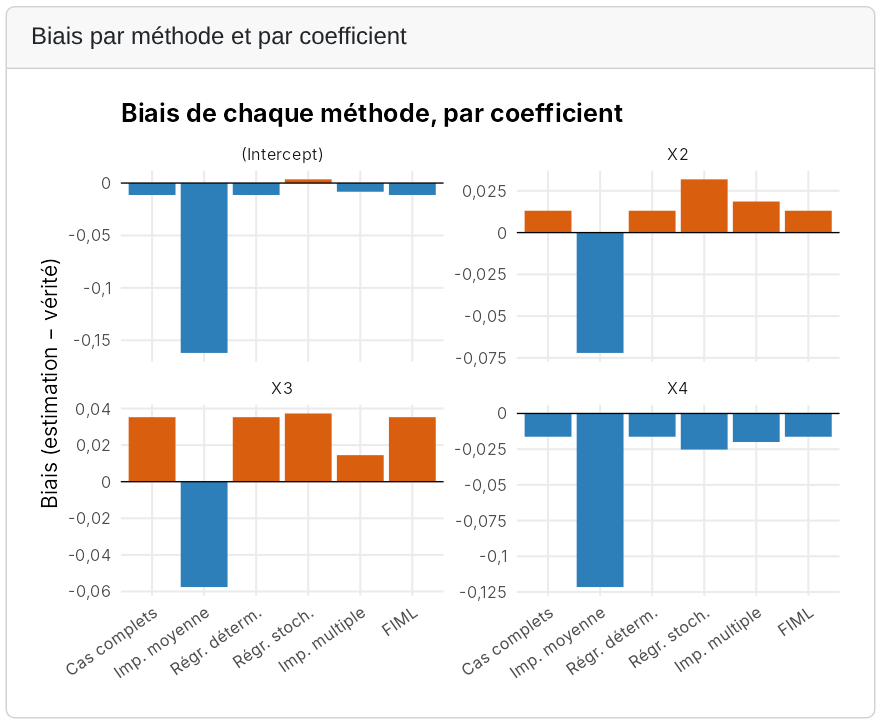

# L'imputation multiple {#sec-imputation-multiple}

```{r}
#| include: false
source("_setup.R")
source("_moteur.R")
cp  <- simuler_complet(400, 4, 0.5, graine = 2416L)
amp <- amputer(cp, 0.35, "MAR", 2416L, var_cible = "X1", var_pilote = "X2")$amp
set.seed(2416L)
mi <- mice::mice(amp, m = 10, printFlag = FALSE)
q <- sapply(1:10, function(k) mean(mice::complete(mi, k)$X1))
u <- sapply(1:10, function(k) var(mice::complete(mi, k)$X1) / 400)
Qb <- mean(q); Ub <- mean(u); B <- var(q); Tt <- Ub + (1 + 1/10) * B
lam <- (1 + 1/10) * B / Tt
```

L'imputation multiple répond au défaut central de l'imputation simple : elle propage
l'incertitude des valeurs imputées jusque dans les erreurs-types. Sous un mécanisme
MAR défendable et avec un modèle d'imputation adéquat, elle peut fournir des
estimations peu biaisées et une inférence correcte. Ce chapitre en expose l'idée,
l'algorithme MICE et les règles de mise en commun de Rubin, avec un calcul complet
sur le scénario de référence. Il approfondit l'onglet **Traitements** de
l'application.

## L'idée de Rubin

L'imputation multiple [@rubin1987] procède en trois temps :

1. **Imputer** $m$ fois le jeu de données. Chaque imputation utilise une composante
   aléatoire, de sorte que les $m$ tableaux complétés diffèrent là où les données
   manquaient.
2. **Analyser** chacun des $m$ tableaux séparément, avec la méthode statistique
   voulue (moyenne, régression, etc.).
3. **Mettre en commun** les $m$ résultats par les règles de Rubin.

La variabilité **entre** les $m$ imputations est la clé : elle mesure l'incertitude
due au manque, celle qu'une imputation unique escamotait. Si l'on ignorait cette
variabilité, on retomberait sur l'imputation stochastique du @sec-cas-complets.

## MICE : l'imputation par équations chaînées

L'algorithme **MICE** [@vanbuuren2011] impute variable par variable, en cycles :
chaque variable incomplète est régressée sur les autres, puis imputée à partir de ce
modèle, et l'on répète jusqu'à stabilisation. La méthode par défaut,
l'**appariement prédictif** (*predictive mean matching*), procède ainsi pour chaque
valeur manquante : elle calcule la valeur prédite par la régression, cherche
quelques individus **observés** dont la prédiction est voisine, et emprunte la
**vraie valeur observée** de l'un d'eux, tiré au hasard. Ce procédé préserve la
distribution des données : pas de valeurs impossibles, pas de décimales là où les
données sont entières.

Pour que les $m$ jeux reflètent toute l'incertitude, MICE tire aussi, à chaque
imputation, les **coefficients** de la régression dans leur distribution
d'échantillonnage, au lieu d'utiliser toujours les mêmes estimations. C'est ce qui
distingue une vraie imputation multiple d'une simple répétition de l'imputation
stochastique.

## Les règles de mise en commun de Rubin

Soit $\hat{Q}_k$ l'estimation obtenue sur le $k$-ième tableau et $U_k$ sa variance
(le carré de son erreur-type). Les règles de Rubin combinent :

$$
\bar{Q} = \frac{1}{m}\sum_{k=1}^m \hat{Q}_k, \qquad
\bar{U} = \frac{1}{m}\sum_{k=1}^m U_k, \qquad
B = \frac{1}{m-1}\sum_{k=1}^m (\hat{Q}_k - \bar{Q})^2,
$$

où $\bar{U}$ est la variance **intra**-imputation (moyenne des incertitudes) et $B$ la
variance **inter**-imputation (le désaccord entre jeux). La variance totale est

$$
T = \bar{U} + \left(1 + \tfrac{1}{m}\right) B .
$$

Le terme $B$ est exactement ce que l'imputation simple oubliait : sans lui, la
variance totale se réduit à $\bar{U}$, et l'erreur-type paraît plus petite qu'elle ne
l'est. Le facteur $1 + 1/m$ corrige le fait que $B$ est lui-même estimé sur un nombre
fini d'imputations.

Une quantité dérivée résume le poids du manque : la **fraction de la variance due au
manque**,

$$
\lambda = \frac{\left(1 + \tfrac{1}{m}\right) B}{T},
$$

qui vaut 0 si les imputations sont toutes identiques et s'approche de 1 si
l'incertitude vient surtout des données absentes.

## Un calcul complet

Appliquons ces règles à la moyenne de $X_1$ dans le scénario de référence, avec
$m = 10$ — le réglage par défaut de l'onglet **Traitements**. La @fig-rubin montre
les dix estimations et leurs intervalles; le @tbl-rubin, les étapes du calcul.

```{r}
#| label: fig-rubin
#| fig-cap: "Les dix estimations de la moyenne de $X_1$, une par jeu imputé, avec leur intervalle à 95 % calculé comme si le jeu était complet (gris). Leur dispersion d'un jeu à l'autre mesure $B$. En bas, l'estimation mise en commun et son intervalle de Rubin (bleu), plus large que chacun des intervalles individuels. Le trait vert marque la vraie moyenne (−0,040), connue en simulation."
#| fig-width: 7
#| fig-height: 4.2
d <- data.frame(lab = c(paste("Jeu", 1:10), "Mise en commun"), est = c(q, Qb),
                se = c(sqrt(u), sqrt(Tt)), type = c(rep("jeu", 10), "commun"))
d$lab <- factor(d$lab, levels = rev(d$lab))
ggplot(d, aes(est, lab, colour = type)) +
  geom_vline(xintercept = mean(cp$X1), colour = COUL_ACC, linetype = "dashed", linewidth = 0.9) +
  geom_vline(xintercept = Qb, colour = COUL_OBS, linewidth = 0.4, alpha = 0.6) +
  geom_errorbarh(aes(xmin = est - 1.96 * se, xmax = est + 1.96 * se), height = 0.25, linewidth = 0.8) +
  geom_point(size = 2.4) +
  scale_colour_manual(values = c(jeu = GRIS, commun = COUL_OBS), guide = "none") +
  sx_fr() + labs(x = "Moyenne estimée de X1 (IC à 95 %)", y = NULL)
```

```{r}
#| label: tbl-rubin
#| tbl-cap: "Les règles de Rubin appliquées à la moyenne de $X_1$ (scénario de référence, $m = 10$)."
tab <- data.frame(
  `Étape` = c("Estimation mise en commun", "Variance intra-imputation", "Variance inter-imputation",
              "Variance totale", "Erreur-type de Rubin", "Erreur-type si l'on oubliait B",
              "Fraction de la variance due au manque"),
  `Formule` = c("$\\bar{Q}$ = moyenne des 10 estimations", "$\\bar{U}$ = moyenne des $U_k$",
                "$B$ = variance des 10 estimations", "$T = \\bar{U} + (1 + 1/10)\\,B$",
                "$\\sqrt{T}$", "$\\sqrt{\\bar{U}}$", "$\\lambda = 1{,}1\\,B / T$"),
  `Valeur` = c(frn(Qb, 3), frn(Ub, 5), frn(B, 5), frn(Tt, 5), frn(sqrt(Tt), 3), frn(sqrt(Ub), 3),
               paste0(frn(100 * lam, 0), " %")), check.names = FALSE)
knitr::kable(tab, align = "llr")
```

Les dix jeux donnent des moyennes qui vont de `r frn(min(q), 3)` à
`r frn(max(q), 3)` : c'est l'incertitude due aux 135 valeurs absentes, rendue
visible. Leur moyenne, $\bar Q = `r frn(Qb, 3)`$, est l'estimation rapportée.
L'erreur-type de Rubin, `r frn(sqrt(Tt), 3)`, dépasse de
`r frn(100 * (sqrt(Tt)/sqrt(Ub) - 1), 0)` % celle que l'on obtiendrait en traitant
un jeu imputé comme complet (`r frn(sqrt(Ub), 3)`). Environ un quart de la variance
(`r frn(100 * lam, 0)` %) tient au manque.

::: {.callout-note}
L'onglet **Traitements** affiche l'estimation mise en commun $\bar{Q}$ de chaque
méthode. Les erreurs-types et la couverture des intervalles, qui demandent de
répéter l'expérience, sont étudiées dans l'**Étude de simulation** (@sec-etude-simulation).
:::

## L'imputation multiple peut corriger le biais

Dans ce scénario MAR, l'imputation multiple se rapproche de la **vérité** en
exploitant la variable observée $X_2$, là où les cas complets sont biaisés pour la
moyenne : −0,050 contre −0,195, pour une vérité de −0,040. Elle fournit aussi une
erreur-type qui intègre l'incertitude d'imputation. Cette réussite n'est pas
automatique : elle suppose que le mécanisme MAR soit une hypothèse défendable et que
le modèle d'imputation contienne les variables utiles.

::: {.app}
**À l'application —** Onglet **Traitements**, *Quantité à estimer* = **Moyenne d'une
variable**, variable $X_1$, réglez le *Nombre d'imputations (m)*, puis *Comparer les
méthodes*. Repérez la ligne *Imputation multiple (mise en commun)* dans le tableau des
estimations et dans le tableau de dispersion.
:::

::: {.voir}
**Ce qu'on doit voir —** Dans *Comparaison des estimations*, l'imputation multiple
se rapproche de la **vérité** (biais −0,010), quand les cas complets et l'imputation
par la moyenne restent biaisés (−0,155) (@fig-cap-trait-moyenne). Dans le tableau de
dispersion, contrairement à l'imputation par la moyenne, elle ne **rétrécit pas**
l'écart-type (1,022, pour une vérité de 0,993) : chaque jeu imputé garde
l'étalement des données.
:::

## Lire l'écran : ce que signifie « mise en commun »

La ligne **Imputation multiple (mise en commun)** ne correspond pas à un seul jeu
« meilleur » que les autres. Elle résume $m$ analyses parallèles. Il faut donc lire
deux objets à la fois : l'estimation mise en commun, qui répond à la question
substantive, et son incertitude, qui porte la trace du manque.

1. Relevez d'abord la quantité choisie et la ligne **Vérité**. Cette comparaison est
   pédagogique et n'est possible qu'en simulation.
2. Comparez ensuite les méthodes naïves à l'imputation multiple ou au FIML. Un écart
   n'est pas une preuve universelle : il dépend du mécanisme simulé, de $N$, de la
   proportion de manque et de la corrélation entre variables.
3. Enfin, reliez la ligne d'imputation multiple au nombre $m$ choisi. Une estimation
   ponctuelle stable ne garantit pas encore une erreur-type stable.

Le rôle de cette ligne est donc de faire distinguer **valeur estimée** et
**incertitude estimée**. Une méthode qui donne une moyenne plausible mais un
intervalle trop étroit reste une mauvaise méthode d'inférence.

## Mettre en commun une régression

La même mécanique s'applique à un modèle multivarié : on ajuste la régression sur
chaque tableau complété, puis on met en commun tous les coefficients par les mêmes
règles de Rubin, coefficient par coefficient.

::: {.callout-note}
Lorsque le manque ne dépend que des **prédicteurs** du modèle, l'analyse des cas
complets est déjà peu biaisée pour les coefficients de régression (@sec-cc-regression); le gain de l'imputation multiple est alors surtout une
**meilleure efficacité**, car elle récupère l'information des lignes autrement
supprimées.
:::

::: {.app}
**À l'application —** Repassez *Quantité à estimer* sur **Coefficients de
régression** (dépendante $X_1$, prédicteurs $X_2$, $X_3$, $X_4$) et *Comparer*. Lisez
le tableau puis le graphique *Biais par méthode et par coefficient*.
:::

{#fig-cap-reg-biais width="80%"}

::: {.voir}
**Ce qu'on doit voir —** Sous ce MAR piloté par un prédicteur, les barres des *cas
complets* sont déjà petites pour les pentes — le point subtil du @sec-cas-complets (@fig-cap-reg-biais). L'*imputation multiple* et le *FIML* restent du même ordre,
tout en exploitant les 135 lignes que les cas complets écartent. L'imputation par la
moyenne, elle, dérape nettement : sa pente de $X_2$ tombe à 0,136 pour une vérité de
0,208.
:::

## Combien d'imputations ?

Un très petit nombre d'imputations, tel que $m = 5$, peut illustrer le mécanisme,
mais constitue rarement un bon choix par défaut pour une analyse rapportée. À mesure
que $m$ augmente, l'erreur de Monte Carlo liée aux imputations diminue; l'estimation
ponctuelle se stabilise généralement avant son erreur-type, ses degrés de liberté et
sa valeur-p. Une règle pratique répandue consiste à prendre au moins autant
d'imputations que le **pourcentage de cas incomplets** [@white2011] — ici, environ 35;
von Hippel [-@vonhippel2020] propose une règle plus fine, fondée sur la fraction
$\lambda$ et la précision voulue pour l'erreur-type. Dans l'application, faites
varier $m$ et vérifiez cette stabilité au @sec-qualite-imputation plutôt que de
retenir un nombre par habitude.

## Exercices {.unnumbered}

**6.1** *(Traitements.)* Sur la moyenne de $X_1$, réglez le *Nombre d'imputations
(m)* successivement sur 5, puis 50, et *Comparez* à chaque fois. L'**estimation**
mise en commun change-t-elle beaucoup ? Que faudrait-il observer, en plus de
l'estimation, pour juger si $m$ est suffisant ? *(Solution : @sec-sol-imputation.)*

**6.2** La variance totale se décompose en $T = \bar{U} + (1 + 1/m)\,B$. Expliquez, en
mots, ce que représente chacune des deux parts. Dans quelle situation la part
**inter**-imputation $B$ pèse-t-elle lourd — quand il manque peu de données, ou
beaucoup ? Reliez votre réponse à la valeur $\lambda = 25\ \%$ du @tbl-rubin.

**6.3** Comparez l'erreur-type de la moyenne obtenue par imputation multiple (0,059)
à celle, naïve, obtenue après imputation par la moyenne : $0{,}836 / \sqrt{400}
\approx 0{,}042$. Laquelle est la plus **honnête**, et pourquoi ? Quel terme des
règles de Rubin la méthode naïve omet-elle entièrement ?

**6.4** Dans la @fig-rubin, l'intervalle mis en commun est plus large que chacun des
dix intervalles individuels. Montrez à l'aide des valeurs du @tbl-rubin que ce
surplus de largeur vient entièrement de $B$.
