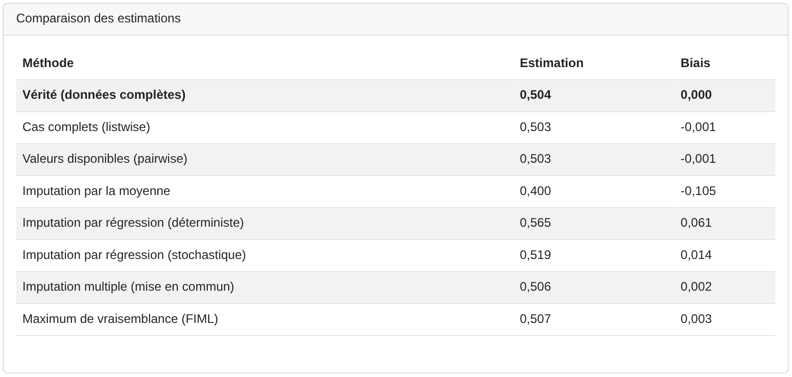

# Le maximum de vraisemblance (FIML) {#sec-fiml}

```{r}
#| include: false
source("_setup.R")
source("_moteur.R")
cp  <- simuler_complet(400, 4, 0.5, graine = 2416L)
amp <- amputer(cp, 0.35, "MAR", 2416L, var_cible = "X1", var_pilote = "X2")$amp
cc  <- amp[complete.cases(amp), ]
```

L'imputation multiple comble les trous avant d'analyser. Le **maximum de
vraisemblance à information complète** (FIML, *Full Information Maximum Likelihood*)
suit une voie différente : il **n'impute rien**. Il estime directement les
paramètres du modèle en maximisant la vraisemblance des données observées, chaque
observation contribuant avec les variables dont elle dispose. Sous un mécanisme MAR,
FIML et imputation multiple sont deux routes principielles vers la même destination.
Ce chapitre correspond à la ligne *Maximum de vraisemblance (FIML)* de l'onglet
**Traitements**, sur le scénario de référence.

## Estimer sans imputer

La vraisemblance d'un jeu complet est le produit des contributions de chaque
observation. Lorsqu'une observation a des valeurs manquantes, FIML n'invente pas ces
valeurs : il **marginalise** sur elles, c'est-à-dire qu'il évalue la contribution de
cette observation sur ses seules variables observées. Formellement, pour des données
multinormales de moyenne $\boldsymbol\mu$ et de covariance $\boldsymbol\Sigma$, la
log-vraisemblance s'écrit

$$
\ell(\boldsymbol\mu, \boldsymbol\Sigma) = \sum_{i=1}^{N}
\log \phi\!\left(\mathbf{y}_{i,\text{obs}} \,;\, \boldsymbol\mu_{i}, \boldsymbol\Sigma_{i}\right),
$$

où $\mathbf{y}_{i,\text{obs}}$ contient les seules valeurs observées de la ligne $i$,
et $\boldsymbol\mu_i$, $\boldsymbol\Sigma_i$ les parties de $\boldsymbol\mu$ et de
$\boldsymbol\Sigma$ qui leur correspondent. Une ligne complète contribue par la
densité à quatre dimensions; une ligne où $X_1$ manque, par la densité à trois
dimensions de $X_2$, $X_3$, $X_4$.

En maximisant cette vraisemblance, on obtient d'un coup les moyennes, variances et
covariances — et, de là, toute quantité qui s'en déduit. Aucune valeur n'est
imputée ; on estime les **paramètres** directement.

::: {.callout-note}
Comme l'imputation multiple, FIML est valide sous un mécanisme **ignorable** (MAR ou
MCAR) : il n'exige pas de modéliser le processus de manque. Les deux méthodes
diffèrent par la mécanique, non par les hypothèses (@sec-mecanismes).
:::

## Comment FIML corrige la moyenne

La formule de vraisemblance peut sembler abstraite. Dans le scénario de référence,
où seule $X_1$ est incomplète, son résultat a une forme très parlante : l'estimation
FIML de la moyenne de $X_1$ est la moyenne des cas complets, **corrigée** de l'écart
entre les cas complets et l'ensemble sur les variables observées :

$$
\hat\mu_1 = \bar{x}_{1,\text{cc}} + \sum_{k=2}^{4} b_k \left(\bar{x}_{k,\text{tous}} - \bar{x}_{k,\text{cc}}\right),
$$

où les $b_k$ sont les coefficients de la régression de $X_1$ sur $X_2$, $X_3$, $X_4$
estimée sur les cas complets. La logique est celle de la @fig-fiml-idee : les cas
complets ont des valeurs de $X_2$ trop basses; puisque $X_1$ monte avec $X_2$, leur
moyenne de $X_1$ est trop basse d'autant, et la droite dit de combien.

```{r}
#| label: fig-fiml-idee
#| fig-cap: "L'idée de FIML, réduite à deux variables. Les points bleus sont les 265 cas complets, et la droite leur régression de $X_1$ sur $X_2$. Les cas complets ont une moyenne de $X_2$ trop basse (trait bleu vertical); la moyenne de $X_2$ sur les 400 lignes (trait vert vertical) est connue, puisque $X_2$ est toujours observée. En suivant la droite, on remonte la moyenne de $X_1$ d'autant : c'est la correction FIML."
#| fig-width: 7
#| fig-height: 4.6
b2 <- coef(lm(X1 ~ X2, cc))
x2c <- mean(cc$X2); x2a <- mean(amp$X2)
y1c <- mean(cc$X1); y1a <- y1c + b2[2] * (x2a - x2c)
ggplot(cc, aes(X2, X1)) +
  geom_point(colour = "#9ecae1", size = 1.2, alpha = 0.8) +
  geom_abline(intercept = b2[1], slope = b2[2], colour = COUL_OBS, linewidth = 1) +
  geom_vline(xintercept = x2c, colour = COUL_OBS, linetype = "dashed") +
  geom_vline(xintercept = x2a, colour = COUL_ACC, linetype = "dashed") +
  annotate("segment", x = -3.2, xend = x2c, y = y1c, yend = y1c, colour = COUL_OBS, linewidth = 0.8) +
  annotate("segment", x = -3.2, xend = x2a, y = y1a, yend = y1a, colour = COUL_ACC, linewidth = 0.8) +
  annotate("segment", x = -2.6, xend = -2.6, y = y1c, yend = y1a, colour = COUL_NA, linewidth = 1,
           arrow = arrow(length = unit(0.18, "cm"))) +
  annotate("label", x = 0.2, y = -2.5, hjust = 0, size = 3.3, label.size = 0,
           label = paste0("correction = pente × écart de X2\n= ", frn(b2[2]), " × ", frn(x2a - x2c), " = ",
                          frn(b2[2] * (x2a - x2c), 3))) +
  annotate("text", x = x2c, y = 3.3, label = paste0("moyenne de X2\ncas complets : ", frn(x2c, 3)),
           hjust = 1.05, size = 3.2, colour = COUL_OBS) +
  annotate("text", x = x2a, y = 3.3, label = paste0("moyenne de X2\n400 lignes : ", frn(x2a, 3)),
           hjust = -0.05, size = 3.2, colour = COUL_ACC) +
  coord_cartesian(xlim = c(-3.2, 3), ylim = c(-3, 3.6)) + sx_fr() + sy_fr() +
  labs(x = expression(X[2]), y = expression(X[1]))
```

Le @tbl-fiml-calcul fait le calcul complet avec les trois variables observées.

```{r}
#| label: tbl-fiml-calcul
#| tbl-cap: "La correction FIML de la moyenne de $X_1$ (scénario de référence). Chaque ligne multiplie le coefficient de régression (estimé sur les cas complets) par l'écart entre la moyenne de toutes les lignes et celle des cas complets."
b <- coef(lm(X1 ~ X2 + X3 + X4, cc))
mall <- colMeans(amp[, 2:4]); mcc <- colMeans(cc[, 2:4]); contr <- b[-1] * (mall - mcc)
tab <- data.frame(Variable = c("X2", "X3", "X4", "Correction totale"),
  `Coefficient b` = c(frn(b[-1], 3), ""),
  `Moyenne (400 lignes)` = c(frn(mall, 3), ""),
  `Moyenne (cas complets)` = c(frn(mcc, 3), ""),
  `Contribution` = frn(c(contr, sum(contr)), 3), check.names = FALSE)
knitr::kable(tab, align = "lrrrr")
fm <- fiml_moyenne(amp, "X1")
```

On obtient $\hat\mu_1 = `r frn(mean(cc$X1), 3)` + `r frn(sum(contr), 3)` =
`r frn(mean(cc$X1) + sum(contr), 3)`$, exactement l'estimation FIML de l'application
(`r frn(fm, 3)`), pour une vérité de −0,040. C'est aussi, à la troisième décimale,
la moyenne après imputation par **régression déterministe** : dans ce cas simple, un
seul patron incomplet et une seule moyenne, les deux calculs coïncident. Ils se
séparent dès que plusieurs variables sont incomplètes, ou pour les variances et les
corrélations, que l'imputation déterministe déforme et que FIML estime correctement.

Faire entrer $X_2$, $X_3$ et $X_4$ dans la vraisemblance est donc essentiel : c'est
par elles, exactement comme l'imputation multiple, que FIML récupère la moyenne que
les cas complets sous-estimaient. Sans ces variables observées, il n'aurait aucun
moyen de corriger la sélection introduite par un manque MAR.

## Les deux voies visent la même information

Confrontées à la vérité, FIML et l'imputation multiple se rapprochent souvent l'une
de l'autre, et de la vérité, dans ce scénario. Ce n'est pas une coïncidence : sous
MAR et avec des modèles convenablement spécifiés, imputer $m$ fois puis mettre en
commun, ou maximiser la vraisemblance des données observées, sont deux façons
cohérentes d'exploiter la même information. Elles ne sont pas nécessairement
identiques dans un échantillon fini : l'imputation multiple comporte une part de
hasard (le tirage des imputations), FIML non.

::: {.app}
**À l'application —** Onglet **Traitements**, *Quantité à estimer* = **Moyenne d'une
variable**, variable $X_1$, puis *Comparer les méthodes*. Repérez les lignes
*Imputation multiple (mise en commun)* et *Maximum de vraisemblance (FIML)*. Passez
ensuite à **Corrélation entre deux variables** ($X_1$, $X_2$), puis aux
**Coefficients de régression**.
:::

{#fig-cap-trait-cor}

::: {.voir}
**Ce qu'on doit voir —** Pour la moyenne, les deux lignes sont **côte à côte**
(−0,050 et −0,054) et toutes deux proches de la vérité (−0,040). Pour la
corrélation, elles le restent (@fig-cap-trait-cor); pour les coefficients de
régression aussi. Deux routes qui exploitent une information semblable, sans
promettre une identité parfaite.
:::

## Lire l'écran : une comparaison de méthodes, pas un concours

Lorsque FIML et l'imputation multiple donnent des nombres voisins, la bonne leçon
n'est pas que l'une « confirme » l'autre. Les deux méthodes reposent sur la même
hypothèse MAR et sur les mêmes variables observées; elles peuvent donc partager le
même biais si cette hypothèse est mal adaptée. Leur accord est rassurant sur la
cohérence du calcul, non une démonstration que MAR est vrai.

Dans l'application, comparez-les en trois étapes : (1) leur distance à la vérité
simulée; (2) leur écart mutuel; (3) leur comportement quand vous changez le
mécanisme ou omettez un prédicteur important. Dans une étude réelle, seule la
deuxième comparaison demeure directement observable; elle doit être complétée par
les diagnostics du @sec-qualite-imputation et, si nécessaire, par la sensibilité
MNAR.

## FIML pour une régression

Le même principe donne les coefficients d'une régression : on spécifie le modèle et
on l'estime par FIML. Un détail compte : il faut laisser la méthode modéliser aussi
la **distribution des prédicteurs**, et non les traiter comme fixés. Ainsi, une ligne
où un prédicteur manque contribue tout de même à la vraisemblance, au lieu d'être
écartée — c'est là que FIML récupère l'information que les cas complets auraient
jetée. L'application estime FIML avec le paquet `lavaan` [@rosseel2012], en
modélisant les prédicteurs.

Une limite mérite d'être connue : quand seule la **variable dépendante** manque et
que l'on n'ajoute aucune variable auxiliaire, FIML donne exactement les coefficients
des cas complets — les lignes sans $Y$ n'apportent rien au modèle de $Y$ sachant $X$.
C'est ce que montre la colonne FIML du tableau de régression : 0,221 pour $X_2$,
comme les cas complets.

## Imputation multiple ou FIML ?

Les deux méthodes sont valides sous MAR ; le choix tient à des considérations
pratiques.

| | Imputation multiple | FIML |
|---|---|---|
| Principe | complète les données, puis analyse | estime les paramètres sans compléter |
| Souplesse | toute analyse ultérieure possible | liée au modèle spécifié |
| Variables auxiliaires | s'ajoutent librement au modèle d'imputation | s'ajoutent, mais alourdissent le modèle |
| Hasard | résultats qui varient légèrement d'une exécution à l'autre | résultat déterministe |
| Sortie | $m$ jeux complétés, réutilisables | paramètres et erreurs-types directs |

: Imputation multiple et FIML, en pratique. {#tbl-mi-fiml}

En pratique, FIML brille lorsqu'on ajuste **un** modèle bien défini (équations
structurelles, régression) [@enders2022]; l'imputation multiple brille lorsqu'on
enchaîne **plusieurs** analyses ou que l'on veut des jeux complétés réutilisables.

::: {.callout-warning}
FIML n'échappe pas à la limite fondamentale : sous **MNAR**, il peut rester biaisé,
tout comme l'imputation multiple. Estimer sans imputer ne crée pas d'information sur
ce qui a disparu sans trace (@sec-sensibilite-mnar).
:::

## Exercices {.unnumbered}

**7.1** *(Traitements.)* Sur les trois quantités (moyenne, corrélation, régression),
relevez l'écart entre les estimations *FIML* et *Imputation multiple*. Est-il petit
devant leur écart aux *cas complets* ? *(Solution : @sec-sol-fiml.)*

**7.2** *(Traitements.)* Passez le mécanisme à **NMAR** dans *Données &
visualisation*, resimulez, et comparez de nouveau les méthodes sur la moyenne de
$X_1$. FIML récupère-t-il encore la vérité ? Reliez votre réponse à l'ignorabilité (@sec-mecanismes).

**7.3** FIML donne de meilleurs coefficients quand il **modélise la distribution des
prédicteurs** plutôt que de les traiter comme fixés — mais seulement si des
prédicteurs comportent eux-mêmes des manquants. Expliquez pourquoi : qu'apporte la
modélisation des prédicteurs lorsqu'une ligne a un prédicteur manquant, et pourquoi
ne change-t-elle rien lorsque tous les prédicteurs sont complets ?

**7.4** À l'aide de la formule de correction et du @tbl-fiml-calcul, expliquez
pourquoi $X_2$ apporte la plus grande part de la correction, alors que son
coefficient $b$ n'est pas le plus grand.
