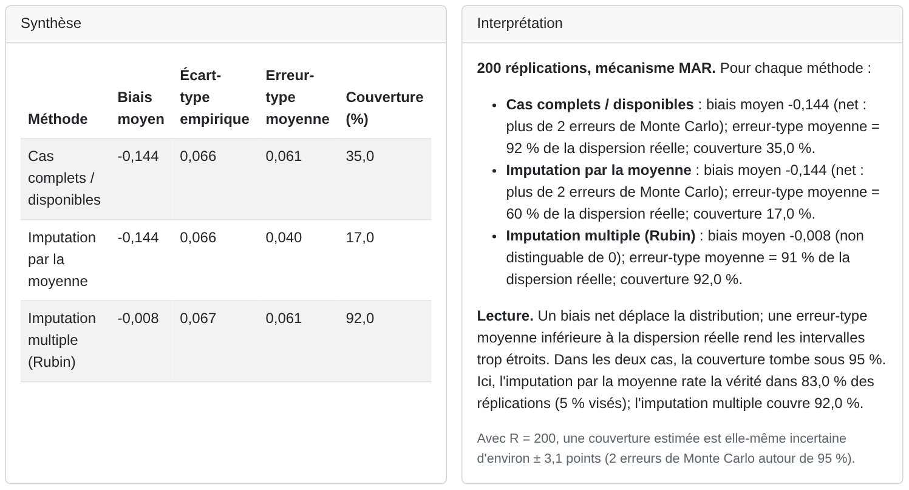
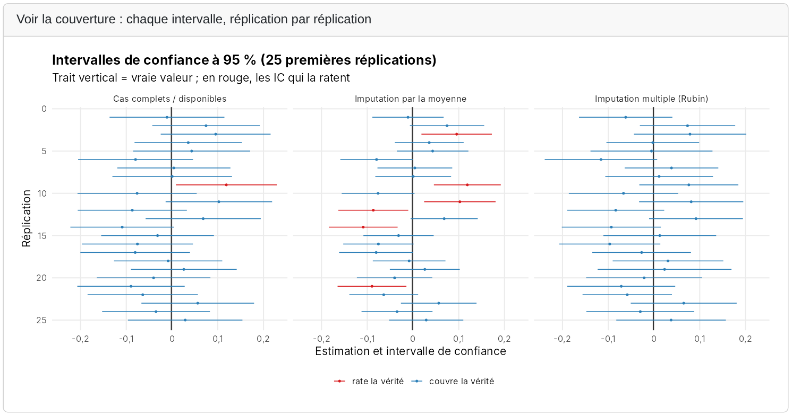
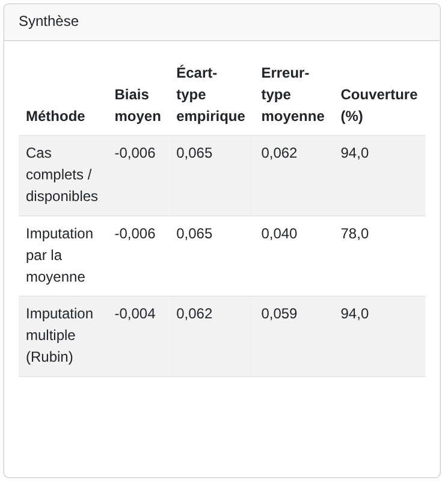

# Étude de simulation : biais, efficacité, couverture {#sec-etude-simulation}

```{r}
#| include: false
source("_setup.R")
```

Un seul jeu de données ne révèle qu'une facette d'une méthode. Pour la juger, il faut
observer son comportement sur de nombreux échantillons — une **étude de simulation**
de Monte Carlo. Ce chapitre distingue trois propriétés que l'on confond souvent : le
biais, l'efficacité et la couverture. Il correspond au sous-onglet **Étude de
simulation** de l'onglet **Évaluer et valider**.

## D'une estimation à une distribution

Les chapitres précédents comparaient des méthodes sur un échantillon unique. Mais une
estimation est une variable aléatoire : elle change d'un échantillon à l'autre. En
répétant $R$ fois le cycle *simuler → amputer → traiter*, on reconstruit la
**distribution d'échantillonnage** de chaque méthode, et l'on peut alors en mesurer
les propriétés.

## Trois propriétés à distinguer

Soit $\hat{Q}_r$ l'estimation d'un paramètre $Q$ obtenue à la $r$-ième réplication,
$r = 1, \ldots, R$, et $\widehat{\mathrm{ET}}_r$ l'erreur-type que la méthode
annonce pour elle.

- Le **biais** est l'écart systématique moyen : $\overline{\hat{Q}} - Q$. Un
  estimateur non biaisé vise juste *en moyenne*.
- L'**efficacité** se lit dans la dispersion des estimations, l'**écart-type
  empirique** $\operatorname{sd}(\hat{Q}_r)$. À biais égal, on préfère l'estimateur le
  moins dispersé.
- La **couverture** est la proportion des intervalles de confiance à 95 % qui
  contiennent la vraie valeur $Q$. Une méthode honnête couvre environ 95 % du temps.

Une quatrième colonne fait le lien entre efficacité et couverture : l'**erreur-type
moyenne** $\overline{\widehat{\mathrm{ET}}}$, ce que la méthode *croit* être sa
précision. Si elle est plus petite que l'écart-type empirique, la méthode se croit
plus précise qu'elle ne l'est, et ses intervalles sont trop étroits.

```{r}
#| label: fig-trois-proprietes
#| fig-cap: "Quatre méthodes imaginaires, quatre distributions d'échantillonnage. Le trait vertical marque la vraie valeur. A : sans biais et efficace. B : sans biais mais peu efficace (distribution large). C : efficace mais biaisée (distribution décalée). D : sans biais et aussi dispersée que A, mais elle annonce une erreur-type deux fois trop petite; ses intervalles (trait sous la courbe) sont trop courts et ratent souvent la vérité."
#| fig-width: 8.5
#| fig-height: 3.2
x <- seq(-1, 1, length.out = 400)
cas <- data.frame(meth = c("A : sans biais, efficace", "B : sans biais, peu efficace",
                           "C : biaisée, efficace", "D : sans biais, trop confiante"),
                  m = c(0, 0, 0.3, 0), s = c(0.12, 0.3, 0.12, 0.12), ann = c(0.12, 0.3, 0.12, 0.06))
d <- do.call(rbind, lapply(seq_len(nrow(cas)), function(i)
  data.frame(meth = cas$meth[i], x = x, y = dnorm(x, cas$m[i], cas$s[i]))))
d$meth <- factor(d$meth, levels = cas$meth); cas$meth <- factor(cas$meth, levels = cas$meth)
ggplot(d, aes(x, y)) + geom_area(fill = "#9ecae1", alpha = 0.7) +
  geom_vline(xintercept = 0, colour = COUL_ACC, linewidth = 0.9) +
  geom_errorbarh(data = cas, aes(y = -0.25, xmin = m - 1.96 * ann, xmax = m + 1.96 * ann, x = m),
                 height = 0.35, colour = COUL_NA, inherit.aes = FALSE, linewidth = 0.9) +
  facet_wrap(~ meth, nrow = 1) + sx_fr() +
  labs(x = "Estimation (vérité = 0)", y = NULL) +
  theme(axis.text.y = element_blank())
```

Ces propriétés sont indépendantes : une méthode peut être non biaisée mais
inefficace (B), efficace mais biaisée (C), ou non biaisée mais mal couvrir parce
qu'elle sous-estime son incertitude (D).

## Le protocole de Monte Carlo

On fixe la vérité en simulant des variables de moyenne nulle; la vérité de référence
est calculée une fois pour toutes sur un très grand échantillon complet (50 000
lignes), ce qui donne pratiquement la valeur de population. À chaque réplication, on
tire un nouvel échantillon, on l'ampute selon le mécanisme courant, on applique trois
méthodes — **cas complets / disponibles**, **imputation par la moyenne** et
**imputation multiple** —, et l'on enregistre l'estimation, son erreur-type et son
intervalle. Après $R$ réplications, on résume les propriétés par méthode.

::: {.callout-warning}
**Le tirage doit changer à chaque réplication.** Si l'on figeait le hasard, les $R$
jeux seraient identiques et la distribution d'échantillonnage s'effondrerait en un
point — l'erreur classique de ce type d'étude. Dans l'application, la réplication $r$
utilise la graine courante augmentée de $r$ : chaque jeu est neuf, et l'étude entière
reste reproductible.
:::

::: {.callout-note}
**Les réglages viennent de la dernière simulation.** N, ρ, le mécanisme, la
proportion de cas incomplets, la variable amputée et le prédicteur du manque sont
ceux du jeu simulé dans **Données & visualisation**. Si vous changez un réglage sans
resimuler, l'étude porte encore sur l'ancien scénario.
:::

## Résultats sous MAR

Lançons l'étude sur le scénario de référence, pour la moyenne de $X_1$.

::: {.app}
**À l'application —** Onglet **Évaluer et valider**, sous-onglet **Étude de
simulation**. Réglez la *Quantité étudiée* sur **Moyenne d'une variable** ($X_1$),
gardez *Nombre de réplications (R)* = 200 et *Imputations par réplication (m)* = 5,
puis *Lancer l'étude* (une vingtaine de secondes). Lisez la carte *Distribution
d'échantillonnage des estimations*, la *Couverture*, puis la *Synthèse* et son
*Interprétation*.
:::

{#fig-cap-mc-dist}

{#fig-cap-mc-synthese}

::: {.voir}
**Ce qu'on doit voir —** Les distributions des *cas complets* et de l'*imputation par
la moyenne* sont superposées et décalées par rapport à la vérité : même biais,
−0,144 (@fig-cap-mc-dist). Celle de l'*imputation multiple* est centrée (biais
−0,008). Dans la *Synthèse* (@fig-cap-mc-synthese), la couverture s'effondre pour
les méthodes naïves (35 % et 17 %) et se tient à 92 % pour l'imputation multiple.
:::

Les deux méthodes naïves ont le même biais; pourquoi l'imputation par la moyenne
couvre-t-elle encore moins bien ? La réponse est dans la colonne *Erreur-type
moyenne* : 0,040 pour l'imputation par la moyenne, contre 0,061 pour les cas
complets, alors que leur dispersion réelle est identique (0,066). L'imputation par
la moyenne est biaisée **et** trop confiante; ses intervalles sont à la fois mal
placés et trop courts.

## L'incertitude de Monte Carlo

Une étude de simulation est elle-même une estimation, faite sur $R$ jeux. Ses
résultats ont donc une marge d'erreur, dite **erreur de Monte Carlo** :

- pour le biais : $\operatorname{sd}(\hat Q_r) / \sqrt{R}$, soit
  $0{,}067 / \sqrt{200} \approx 0{,}005$ ici; un biais moyen de −0,008 est donc
  compatible avec zéro, au double de cette marge près;
- pour une couverture $c$ : $\sqrt{c(1-c)/R}$, soit environ 1,5 point autour de
  95 % avec $R = 200$. Une couverture de 92 % se situe ainsi à deux marges de la
  cible : proche, sans être parfaite. Avec $m = 5$ imputations seulement, une légère
  sous-couverture de l'imputation multiple n'a rien d'anormal.

L'application rappelle cette marge sous l'*Interprétation*, et qualifie chaque biais
de « net » lorsqu'il dépasse deux erreurs de Monte Carlo.

## Lire l'écran : une étude de Monte Carlo est une distribution, pas un verdict

Le sous-onglet **Étude de simulation** présente quatre sorties complémentaires.
Lisez-les dans cet ordre, car elles répondent à quatre questions différentes.

| Sortie | Question | Lecture | Limite |
|---|---|---|---|
| **Distribution d'échantillonnage** | Les estimations sont-elles centrées sur la vérité ? | Centre décalé = biais; nuage étalé = faible efficacité. | Avec peu de réplications, le centre apparent est lui-même bruité. |
| **Couverture des IC à 95 %** | Les intervalles contiennent-ils la vérité environ 95 % du temps ? | Sous-couverture = inférence trop optimiste ou biaisée. | 95 % est une cible à long terme, non un chiffre exact à chaque lancement. |
| **Chaque intervalle** | Comment se produisent les échecs de couverture ? | Les traits qui ne croisent pas la vérité rendent visible le taux résumé. | L'ordre des réplications n'a pas de sens substantif. |
| **Synthèse** | Biais, dispersion empirique, erreur-type moyenne et couverture concordent-ils ? | L'erreur-type moyenne doit refléter l'écart-type empirique. | Ce diagnostic ne vaut que pour le scénario simulé. |

: Les quatre sorties de l'étude de simulation. {#tbl-sorties-mc}

Une bonne lecture relie toujours les colonnes : une méthode peut être centrée mais
sous-couvrir parce qu'elle sous-estime son erreur-type; elle peut aussi couvrir mal
parce qu'elle est biaisée. Le mot « meilleure » n'a de sens qu'après avoir précisé la
propriété que l'on compare.

## Isoler la couverture : le cas MCAR

Pour séparer nettement le biais de la couverture, plaçons-nous sous MCAR, où, pour la
moyenne étudiée ici, toutes les méthodes visent juste en moyenne. Le résultat est
frappant : l'imputation par la moyenne est **non biaisée** pour cette cible, et
pourtant sa couverture tombe à 78 %. La cause se lit dans la comparaison de deux
écarts-types : l'**erreur-type moyenne** qu'affiche la méthode (0,040) est bien plus
petite que l'**écart-type empirique** (0,065), la vraie dispersion de ses
estimations. La méthode se croit plus précise qu'elle ne l'est : c'est le cas D de
la @fig-trois-proprietes.

::: {.app}
**À l'application —** Dans *Données & visualisation*, passez le mécanisme à **MCAR**
et resimulez (graine 2416 toujours fixée). Revenez à l'**Étude de simulation**,
relancez-la, et examinez la carte *Voir la couverture : chaque intervalle,
réplication par réplication*, puis la *Synthèse*.
:::

{#fig-cap-mc-intervalles}

{#fig-cap-mc-mcar-synthese width="60%"}

::: {.voir}
**Ce qu'on doit voir —** Chaque trait horizontal est un intervalle de confiance ; le
trait vertical est la vérité. Pour l'imputation par la moyenne, les intervalles sont
plus courts et ratent plus souvent la vérité, alors même que la méthode est *non
biaisée* sous MCAR (@fig-cap-mc-intervalles). Pour les cas complets et l'imputation
multiple, la couverture est de 94 % (@fig-cap-mc-mcar-synthese), comme il se doit.
:::

::: {.callout-tip}
Une méthode peut viser juste et néanmoins tromper. La couverture ne dépend pas que du
biais : elle exige que l'erreur-type reflète la vraie variabilité. C'est précisément
ce que l'imputation multiple assure, en ajoutant la variance inter-imputation $B$ (@sec-imputation-multiple), et ce que l'imputation simple néglige.
:::

## Exercices {.unnumbered}

**8.1** *(Étude de simulation.)* Sous MCAR, faites passer le *Nombre de réplications
(R)* de 200 à 500. La couverture de l'imputation multiple se rapproche-t-elle de
95 % ? Calculez l'erreur de Monte Carlo d'une couverture de 95 % pour $R = 200$ et
$R = 500$. Qu'en déduisez-vous sur la précision d'une couverture estimée sur peu de
réplications ? *(Solution : @sec-sol-simulation.)*

**8.2** L'imputation par régression **stochastique**, appliquée **une seule fois**,
produit des valeurs plausibles et un écart-type correct (@sec-cas-complets). Sa
*couverture* serait-elle pour autant correcte ? Expliquez pourquoi une imputation
unique, même stochastique, sous-estime encore l'incertitude — quel terme des règles
de Rubin lui manque-t-il ?

**8.3** *(Étude de simulation.)* Sous MAR, faites varier la *Proportion de cas
incomplets* de 0,2 à 0,6 (en resimulant à chaque fois). Comment évoluent le biais des
cas complets et la couverture de l'imputation multiple à mesure que le manque
s'étend ?

**8.4** *(Étude de simulation.)* Sous MAR, choisissez la *Quantité étudiée*
**Corrélation entre deux variables** ($X_1$, $X_2$) et lancez l'étude. Les cas
complets sont-ils encore fortement biaisés ? Reliez votre observation à la
@fig-cc-regression.
