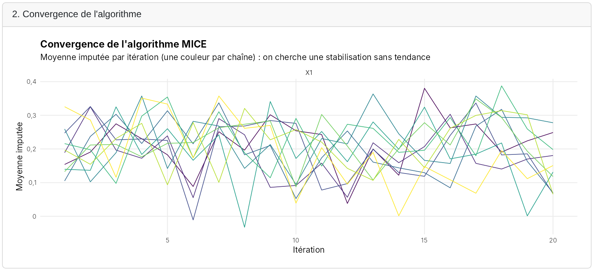
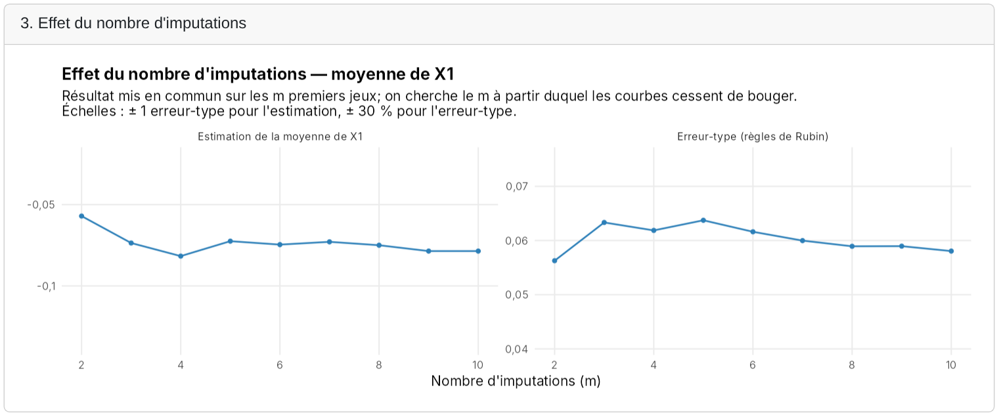

# Diagnostics de qualité d'une imputation {#sec-qualite-imputation}

```{r}
#| include: false
source("_setup.R")
```

En simulation, on juge une méthode en la confrontant à la vérité. Sur de vraies
données, cette vérité n'existe pas : les valeurs manquantes le restent. Comment,
alors, s'assurer qu'une imputation est raisonnable ? Ce chapitre présente trois
diagnostics qui ne demandent aucune vérité de référence. Il correspond au sous-onglet
**Qualité de l'imputation** de l'onglet **Évaluer et valider**.

::: {.app}
**À l'application —** Avec le scénario de référence, onglet **Évaluer et valider**,
sous-onglet **Qualité de l'imputation**. Réglez la *Variable imputée à examiner* sur
$X_1$, gardez *Nombre d'imputations (m)* = 10 et *Itérations MICE (maxit)* = 20,
puis *Lancer l'imputation*. L'imputation est calculée une seule fois, puis examinée
sous trois angles.
:::

## Observé contre imputé

Une imputation raisonnable produit des valeurs **plausibles** : dans le même registre
que les valeurs observées, sans aberrations évidentes. On superpose donc la
distribution des valeurs observées à celles des valeurs imputées, jeu par jeu. Cette
comparaison est un contrôle de cohérence, non un test de validité : une distribution
imputée jolie peut encore provenir d'un modèle mal choisi.

::: {.callout-note}
Un **décalage systématique** entre observé et imputé n'est pas anormal : sous MAR,
c'est même le signe que l'imputation corrige le biais en exploitant les variables
observées. Dans le scénario de référence, les valeurs manquantes de $X_1$
correspondent à des $X_2$ élevés; leurs imputations doivent donc être plus élevées
que les valeurs observées. Ce qui alerterait, ce sont des valeurs **hors échelle** ou
une forme radicalement différente.
:::

{#fig-cap-qi-obsimp}

::: {.voir}
**Ce qu'on doit voir —** Les densités imputées (fines) restent dans le **registre**
des observées (épaisse) : même forme, même échelle (@fig-cap-qi-obsimp). Elles sont
décalées vers la droite : c'est la correction attendue sous MAR, pas une aberration.
Les dix courbes fines diffèrent un peu entre elles : c'est l'incertitude
d'imputation, que les règles de Rubin traduisent en $B$.
:::

## La convergence de l'algorithme

L'imputation par équations chaînées procède par **itérations** : elle impute variable
par variable, en cycles répétés, et chacune des $m$ imputations forme une
**chaîne** indépendante. Il faut vérifier que ces cycles se sont **stabilisés**. On
suit, au fil des itérations, une quantité résumée des valeurs imputées (leur
moyenne), avec une courbe par chaîne. La @fig-convergence-schema montre les deux
situations à distinguer.

```{r}
#| label: fig-convergence-schema
#| fig-cap: "Schéma (séries fictives). À gauche, une convergence satisfaisante : les chaînes partent de points différents mais se mélangent rapidement autour d'un même niveau, sans tendance. À droite, un défaut de convergence : les chaînes dérivent ensemble ou restent séparées; il faut plus d'itérations ou un modèle d'imputation revu."
#| fig-width: 8.5
#| fig-height: 3.2
set.seed(7); it <- 1:20
bon <- do.call(rbind, lapply(1:5, function(k) {
  x <- numeric(20); x[1] <- rnorm(1, 0, 0.6)
  for (t in 2:20) x[t] <- 0.3 * x[t - 1] + rnorm(1, 0, 0.12)
  data.frame(cas = "Convergence satisfaisante", chaine = k, it = it, y = x + 0.1) }))
mauv <- do.call(rbind, lapply(1:5, function(k) {
  off <- c(-0.5, -0.25, 0, 0.25, 0.5)[k]
  data.frame(cas = "Défaut de convergence", chaine = k, it = it,
             y = off * exp(-it / 40) + 0.03 * it + rnorm(20, 0, 0.05)) }))
d <- rbind(bon, mauv); d$cas <- factor(d$cas, levels = c("Convergence satisfaisante", "Défaut de convergence"))
ggplot(d, aes(it, y, colour = factor(chaine), group = chaine)) +
  geom_line(linewidth = 0.7) + facet_wrap(~ cas) +
  scale_colour_viridis_d(guide = "none", end = 0.9) + sy_fr() +
  labs(x = "Itération", y = "Moyenne imputée")
```

{#fig-cap-qi-conv}

::: {.voir}
**Ce qu'on doit voir —** Les chaînes doivent **s'entrelacer** autour d'un niveau
stable, sans dérive (@fig-cap-qi-conv). Dans ce scénario simple, une seule variable
est incomplète : la convergence est presque immédiate, et réduire *maxit* à 5 ne
change pas l'allure des traces. Le diagnostic devient décisif quand plusieurs
variables incomplètes s'imputent mutuellement.
:::

## L'effet du nombre d'imputations

Combien d'imputations retenir ? On suit l'estimation d'intérêt — ici la moyenne de
$X_1$ — et son erreur-type à mesure que $m$ augmente, en appliquant les règles de
Rubin aux $m$ premiers jeux seulement : $m = 2$, puis 3, et ainsi de suite. On
cherche le nombre à partir duquel les deux courbes cessent de bouger de façon
notable. Pour juger de ce qui est « notable », l'application trace l'estimation sur
une échelle de plus ou moins une erreur-type, et l'erreur-type sur une échelle de
plus ou moins 30 %.

{#fig-cap-qi-effetm}

::: {.voir}
**Ce qu'on doit voir —** Avec peu de jeux, l'estimation et surtout l'erreur-type
dépendent du hasard des premières imputations; elles se stabilisent à mesure que $m$
croît (@fig-cap-qi-effetm). L'erreur-type demande en général plus d'imputations,
parce que $B$, une variance, s'estime moins bien qu'une moyenne sur un petit nombre
de jeux. Augmentez *m* à 30 pour voir les courbes s'aplatir davantage.
:::

## Une liste de vérifications

Avant de faire confiance à une imputation, on s'assure que :

- les valeurs imputées restent **dans le registre** des valeurs observées (densités) ;
- les chaînes ont **convergé** (traces stables, bien mélangées) ;
- l'estimation et son erreur-type sont **stables** pour le $m$ retenu ;
- le modèle d'imputation inclut bien les variables liées au manque et à l'analyse
  visée — sans quoi l'hypothèse MAR serait compromise.

## Lire l'écran : trois diagnostics, aucune garantie automatique

| Carte | Ce qu'elle peut rassurer | Signal d'alerte | Ce qu'elle ne valide pas |
|---|---|---|---|
| **Observées vs imputées** | Les imputations sont sur une échelle et dans une plage plausibles. | Valeurs impossibles, hors plage ou forme incohérente. | L'hypothèse MAR ou l'absence de biais. |
| **Convergence de l'algorithme** | Les chaînes ne dérivent plus et se mélangent raisonnablement. | Tendance durable, chaînes séparées, oscillations persistantes. | Le caractère correct du modèle d'imputation après convergence. |
| **Effet du nombre d'imputations** | Le choix de $m$ donne des résultats numériquement stables. | Estimation ou erreur-type qui continue de bouger fortement. | La pertinence substantive des variables incluses. |

: Les trois diagnostics d'imputation et leurs limites. {#tbl-diag-imputation}

Ces diagnostics n'ont donc pas le statut d'un feu vert unique. Une imputation est
défendable lorsqu'ils s'ajoutent à un modèle riche, construit à partir de la question
d'analyse et de la connaissance du processus de collecte.

## Exercices {.unnumbered}

**9.1** *(Qualité de l'imputation.)* Réglez *maxit* sur 5, puis sur 40, et relancez.
Les traces de convergence changent-elles d'allure ? Pourquoi la convergence est-elle
si rapide dans ce scénario ? *(Solution : @sec-sol-qualite.)*

**9.2** *(Qualité de l'imputation.)* Sur la carte observé/imputé, comparez un
mécanisme MAR (scénario de référence) à un mécanisme MCAR (resimulé avec la même
graine). Sous lequel le décalage entre observé et imputé disparaît-il, et pourquoi ce
décalage est-il, sous MAR, un signe sain plutôt qu'un défaut ?

**9.3** L'estimation ponctuelle d'une moyenne se stabilise dès un petit $m$.
Pensez-vous que l'erreur-type d'un **coefficient de régression** se stabilise aussi
vite que celle d'une moyenne, ou plus lentement ? Justifiez à partir de la part de
variance inter-imputation $B$ que chaque quantité comporte.
