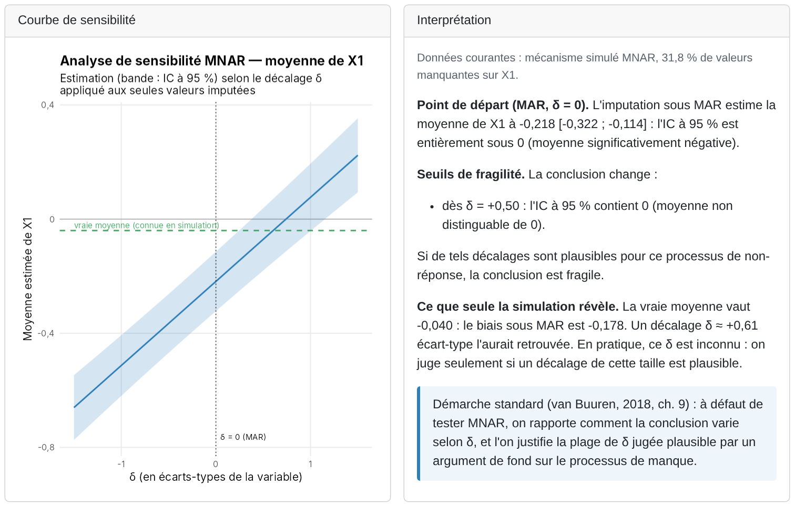

# L'analyse de sensibilité sous MNAR {#sec-sensibilite-mnar}

```{r}
#| include: false
source("_setup.R")
source("_moteur.R")
cp   <- simuler_complet(400, 4, 0.5, graine = 2416L)
ampN <- amputer(cp, 0.35, "MNAR", 2416L, var_cible = "X1")$amp
```

Le @sec-diagnostic-little l'a établi : on ne peut pas *tester* un mécanisme MNAR. On
n'est pourtant pas démuni. Plutôt que de trancher, on **encadre** l'effet d'un
éventuel manque non aléatoire sur les conclusions : c'est l'analyse de sensibilité.
Ce chapitre présente le delta-ajustement [@vanbuuren2018]. Il correspond au
sous-onglet **Sensibilité MNAR** de l'onglet **Mécanisme du manque**.

## Le principe du delta-ajustement

L'idée est simple. On impute d'abord sous l'hypothèse MAR. Puis on suppose que les
valeurs réellement manquantes sont systématiquement **décalées** d'une quantité
$\delta$ par rapport à ce que MAR prédit — par exemple, plus élevées si l'on redoute
que les grandes valeurs manquent davantage. On applique ce décalage aux seules
valeurs imputées, on refait l'analyse, et l'on **balaie une plage de $\delta$**,
commodément exprimé en écarts-types de la variable.

Formellement, si $\tilde{y}_{ik}$ est la valeur imputée sous MAR pour la ligne
manquante $i$ dans le jeu $k$, on la remplace par

$$
\tilde{y}_{ik}(\delta) = \tilde{y}_{ik} + \delta \times s_y,
$$

où $s_y$ est l'écart-type des valeurs observées. On analyse les $m$ jeux ainsi
modifiés et l'on met en commun par les règles de Rubin, pour chaque valeur de
$\delta$.

Le paramètre $\delta$ encode l'ampleur du manque non aléatoire redouté : $\delta = 0$
correspond exactement à MAR. En le faisant varier, on répond à la question qui
importe vraiment : *mes conclusions résistent-elles à un écart plausible par rapport
à MAR ?*

Le signe de $\delta$ doit être interprété dans l'échelle de la variable. Un $\delta$
positif suppose ici que les valeurs manquantes sont, toutes choses égales par
ailleurs, plus élevées que ne le prédit MAR; un $\delta$ négatif suppose l'inverse.
La plage ne se choisit pas parce qu'elle « couvre large », mais à partir de
connaissances de domaine, d'études externes ou d'un scénario de non-réponse explicite.

```{r}
#| label: fig-delta
#| fig-cap: "Le delta-ajustement sur le scénario de référence rendu MNAR (les valeurs élevées de $X_1$ s'effacent elles-mêmes). En bleu, les valeurs imputées sous MAR : elles se calent sur la relation observée entre $X_1$ et les autres variables, et restent trop basses. En orange, les mêmes valeurs décalées de $\\delta = +0{,}6$ écart-type. En vert, les vraies valeurs effacées, connues seulement en simulation : le décalage les rejoint."
#| fig-width: 7
#| fig-height: 3.8
set.seed(2416L)
mi <- mice::mice(ampN, m = 10, printFlag = FALSE)
manq <- is.na(ampN$X1); s <- sd(ampN$X1, na.rm = TRUE)
imp <- unlist(lapply(1:10, function(k) mice::complete(mi, k)$X1[manq]))
d <- rbind(data.frame(type = "Imputées sous MAR (δ = 0)", x = imp),
           data.frame(type = "Imputées décalées (δ = +0,6)", x = imp + 0.6 * s),
           data.frame(type = "Vraies valeurs effacées", x = rep(cp$X1[manq], 10)))
d$type <- factor(d$type, levels = unique(d$type))
ggplot(d, aes(x, colour = type, fill = type)) +
  geom_density(alpha = 0.15, linewidth = 1, key_glyph = "path") +
  scale_colour_manual(values = c(COUL_OBS, COUL_NA, COUL_ACC), name = NULL) +
  scale_fill_manual(values = c(COUL_OBS, COUL_NA, COUL_ACC), name = NULL) +
  sx_fr() + sy_fr() + labs(x = expression(X[1]), y = "Densité") +
  guides(fill = "none", colour = guide_legend(nrow = 1))
```

## La courbe de sensibilité

On trace l'estimation et son intervalle de confiance en fonction de $\delta$. Chaque
point de la courbe est une analyse complète : imputer sous MAR, décaler les imputées
de $\delta$, mettre en commun par les règles de Rubin. En simulation, où les données
sont fabriquées, on peut superposer la **vraie** moyenne : la courbe la traverse au
$\delta$ correspondant au véritable mécanisme.

::: {.app}
**À l'application —** Dans *Données & visualisation*, gardez le scénario de
référence mais réglez le mécanisme sur **NMAR (MNAR)**, et resimulez. Onglet
**Mécanisme du manque**, sous-onglet **Sensibilité MNAR** : choisissez la *Variable
suspectée MNAR* ($X_1$), gardez l'*Amplitude de δ explorée* à ±1,5 et le *Nombre
d'imputations (m)* à 10, puis *Lancer l'analyse*. Lisez la *Courbe de sensibilité*
et son *Interprétation*.
:::

{#fig-cap-sens}

::: {.voir}
**Ce qu'on doit voir —** À $\delta = 0$, l'estimation sous MAR vaut −0,218, avec un
intervalle [−0,322 ; −0,114] entièrement sous 0 : prise au pied de la lettre,
l'analyse conclurait à une moyenne négative. En balayant $\delta$, la courbe monte;
dès $\delta = +0{,}5$, l'intervalle contient 0 et cette conclusion disparaît. La
courbe **traverse** la vraie moyenne vers $\delta \approx +0{,}61$ (@fig-cap-sens) —
un repère qui n'existe qu'en simulation.
:::

L'estimation sous MAR ($\delta = 0$) est biaisée de −0,178 : l'imputation multiple a
corrigé une partie du biais des cas complets (−0,286), grâce au lien entre $X_1$ et
les autres variables, mais pas tout (@fig-delta). La vraie moyenne aurait été
retrouvée pour un **$\delta$ récupérateur** positif, puisque le manque touche les
valeurs élevées de la variable. En pratique, ce $\delta$ est **inconnu** : la courbe
ne dit pas où est la vérité, seulement de combien la conclusion bougerait selon
l'ampleur du décalage.

## Lecture décisionnelle : les seuils de fragilité

::: {.callout-tip}
L'analyse de sensibilité ne cherche pas la « bonne » valeur de $\delta$ — invérifiable
— mais la **robustesse** de la conclusion. Si la décision reste stable sur toute une
plage plausible de $\delta$, la conclusion est robuste. Si elle bascule pour un
$\delta$ modeste, elle est fragile et doit être présentée avec prudence.
:::

L'application résume la courbe par des **seuils de fragilité** : partant de
$\delta = 0$, elle cherche, de chaque côté, le premier $\delta$ où la décision
« l'intervalle exclut 0 » change. Dans l'exemple ci-dessus, la conclusion « moyenne
négative » tient pour tout $\delta$ négatif exploré, mais tombe dès $\delta = +0{,}5$.
La question devient alors substantielle : est-il plausible que les valeurs manquantes
soient, en moyenne, plus élevées d'un demi-écart-type que ce que prédit MAR ? Si le
processus de non-réponse rend ce scénario crédible, la conclusion est fragile.

La démarche recommandée [@vanbuuren2018] consiste donc à rapporter la courbe de
sensibilité, à justifier la plage de $\delta$ jugée plausible par un **argument de
fond** sur le processus de manque, et à conclure sur la stabilité — ou l'instabilité
— des résultats à l'intérieur de cette plage.

## Et si le manque était MAR ?

L'analyse de sensibilité n'est pas réservée aux données MNAR : sur de vraies données,
on ne sait jamais lequel des deux mécanismes est à l'œuvre. Appliquée au scénario de
référence (vraiment MAR), elle donne une estimation à $\delta = 0$ de −0,050, dont
l'intervalle contient 0, et une courbe qui croise la vraie moyenne près de
$\delta = 0$ (+0,03). La conclusion « moyenne non distinguable de 0 » bascule dès
$\delta = +0{,}5$ ou $\delta = -0{,}25$ : avec une moyenne proche de 0, presque
n'importe quel décalage la rend significative. Cela montre que le seuil de fragilité
dépend de la **question** posée autant que des données.

## Lire l'écran : une courbe conditionnelle à un scénario

Pour lire la carte **Courbe de sensibilité**, commencez par le point $\delta = 0$ :
il correspond à l'analyse sous MAR. Déplacez-vous ensuite vers les valeurs positives
et négatives et relevez le premier $\delta$ où la conclusion pertinente change —
un intervalle qui franchit zéro, un effet qui passe sous un seuil ou une décision de
classement qui s'inverse. Ce point est un **seuil de fragilité**, pas une estimation
de la vraie valeur de $\delta$.

En simulation, la ligne de vérité et le « $\delta$ récupérateur » servent uniquement
à enseigner la mécanique. En pratique, ils disparaissent. Un rapport rigoureux donne
la plage explorée, sa justification et ce qui reste stable à l'intérieur de cette
plage; il ne prétend jamais avoir identifié le mécanisme MNAR.

## Exercices {.unnumbered}

**10.1** *(Sensibilité MNAR.)* Appliquez l'analyse au scénario de référence, dont le
manque est en réalité **MAR**. Le $\delta$ récupérateur est-il proche de zéro ?
Pourquoi est-ce précisément ce qu'on attend quand le vrai mécanisme est MAR ?
*(Solution : @sec-sol-sensibilite.)*

**10.2** *(Sensibilité MNAR.)* Sur les données MNAR, élargissez l'*Amplitude de δ
explorée* jusqu'à ±3. À partir de quel $\delta$ l'intervalle de confiance devient-il
entièrement **positif** ? Que dit ce second seuil sur la conclusion « la moyenne
diffère de 0 » ?

**10.3** Fixez un seuil décisionnel — par exemple « la moyenne dépasse-t-elle
−0,1 ? » — et repérez sur la courbe le $\delta$ à partir duquel la conclusion
change. Si un expert juge que les non-répondants ne diffèrent pas de plus de
0,3 écart-type de ce que prédit MAR, diriez-vous que la conclusion est robuste ?
