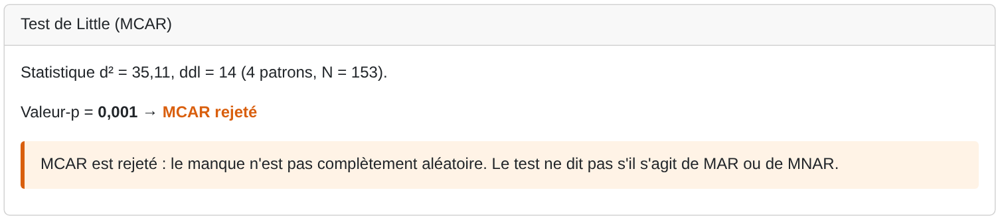
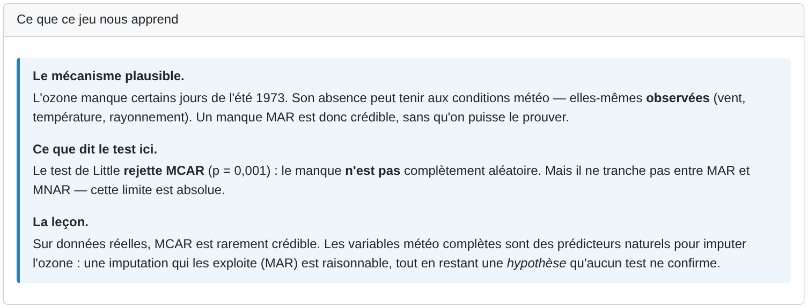
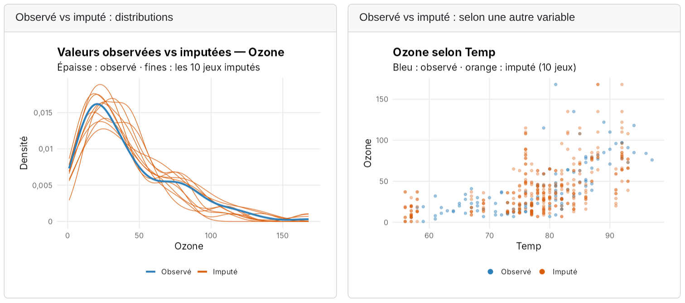
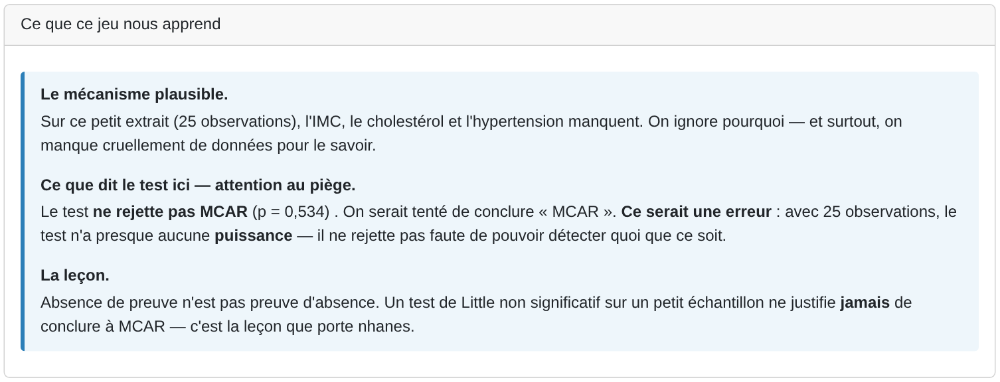
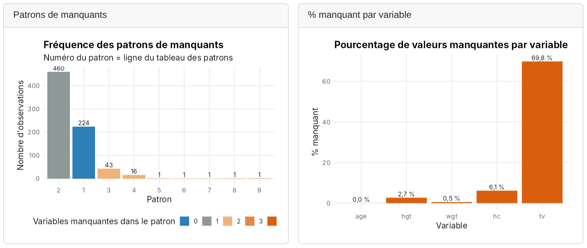

# Données réelles : études de cas {#sec-donnees-reelles}

Sur de vraies données, la vérité n'existe pas : on ne peut plus mesurer le biais. Mais
toute la démarche des chapitres précédents — visualiser, tester MCAR, imputer,
diagnostiquer — reste applicable. Ce chapitre l'illustre sur trois jeux classiques. Il
correspond à l'onglet **Données réelles** de l'application, qui enchaîne toute la
chaîne d'analyse.

::: {.app}
**À l'application —** Onglet **Données réelles**. Choisissez un *Jeu de données*
(*airquality*, *nhanes* ou *boys*), une *Variable pour observé/imputé* et une
*Variable en abscisse (nuage)*, puis cliquez sur *Imputer et diagnostiquer*. L'onglet
déroule toute la démarche : description du jeu, cartouches, *Aperçu des données*,
*Carte des valeurs manquantes*, *Patrons de manquants*, *% manquant par variable*,
*Test de Little (MCAR)*, deux graphiques *Observé vs imputé* et la carte *Ce que ce
jeu nous apprend*. Si vous changez de jeu, relancez l'imputation.
:::

::: {.callout-note}
Sur ces jeux, l'imputation utilise toujours la même graine (2024) : vos graphiques
seront identiques à ceux de ce guide. Le nombre d'itérations est fixé à 15.
:::

| Jeu | Lignes | Cellules manquantes | Cas incomplets | Test de Little |
|---|---|---|---|---|
| *airquality* | 153 | 4,8 % | 27,5 % | $d^2 = 35{,}11$, 14 ddl, $p = 0{,}001$ |
| *nhanes* | 25 | 27,0 % | 48,0 % | $d^2 = 8{,}00$, 9 ddl, $p = 0{,}534$ |
| *boys* | 748 | 15,8 % | 70,1 % | $d^2 = 247{,}85$, 21 ddl, $p < 0{,}001$ |

: Les trois jeux réels en un coup d'œil. {#tbl-jeux-reels}

## Qualité de l'air (*airquality*)

Le jeu *airquality* rassemble des mesures quotidiennes à New York, de mai à septembre
1973 (153 jours). L'ozone manque 37 jours et le rayonnement solaire 7 jours; le vent,
la température, le mois et le jour sont complets.

{#fig-cap-air-little width="85%"}

Le test de Little **rejette MCAR** : le manque n'est pas compatible avec une absence
de structure. On ne peut pas dire s'il est MAR ou MNAR, mais les variables météo
complètes constituent des prédicteurs plausibles à inclure dans une imputation sous
MAR (@fig-cap-air-lecon).

{#fig-cap-air-lecon width="90%"}

{#fig-cap-air-imp}

::: {.voir}
**Ce qu'on doit voir —** Les imputations de l'ozone restent dans le registre observé,
y compris la longue queue droite des journées très polluées (@fig-cap-air-imp). Le
nuage selon la température montre qu'elles respectent la relation physique connue.
Ces graphiques vérifient la plausibilité; ils ne confirment pas à eux seuls le
mécanisme.
:::

## NHANES (petit échantillon)

Le jeu *nhanes* [@schafer1997] ne compte que 25 observations — un cas d'école pour la
**puissance**. L'âge (en trois groupes) est complet; l'indice de masse corporelle,
l'hypertension et le cholestérol manquent pour 8 à 10 personnes chacun. Près de la
moitié des lignes sont incomplètes.

{#fig-cap-nhanes width="90%"}

Ici, le test **ne rejette pas** MCAR. Attention au piège : ce non-rejet ne prouve pas
que les données sont MCAR. Sur 25 observations réparties en 5 patrons, la puissance
est très faible — l'absence de preuve n'est pas une preuve d'absence (@sec-diagnostic-little). L'imputation reste possible, mais ses résultats seront très
incertains, et la part $B$ de la variance de Rubin sera grande.

## Croissance de garçons (*boys*)

Le jeu *boys* [@fredriks2000] décrit 748 garçons néerlandais âgés de 0 à 21 ans.
L'application en retient cinq variables numériques : âge, taille, poids, périmètre
crânien et volume testiculaire (*tv*). Le volume testiculaire manque pour 522 garçons
(70 %), surtout chez les plus jeunes : on ne le mesure pas avant la puberté.

{#fig-cap-boys-patrons}

C'est une illustration très plausible d'un mécanisme MAR : le manque dépend de l'âge,
qui est **observé**, et l'âge doit alors faire partie du modèle d'imputation. Le test
rejette nettement MCAR ($p < 0{,}001$), comme attendu, mais ne transforme pas cette
plausibilité en preuve.

::: {.app}
**À l'application —** Jeu *boys*, *Variable pour observé/imputé* = *tv*, *Variable
en abscisse (nuage)* = *age*, puis *Imputer et diagnostiquer*.
:::

{#fig-cap-boys-imp}

::: {.voir}
**Ce qu'on doit voir —** À gauche, le contraste entre observé et imputé est
spectaculaire (@fig-cap-boys-imp) : la plupart des valeurs manquantes concernent des
enfants, dont le volume testiculaire est petit. Ce n'est **pas** un défaut : c'est la
correction MAR à l'œuvre. Le nuage de droite le confirme, en montrant que les valeurs
imputées respectent la relation entre l'âge et le volume. Sans ce nuage, on aurait pu
prendre le décalage des densités pour une anomalie.
:::

## Une démarche récapitulative

Sur des données réelles, on procède ainsi :

1. **Décrire** le manque : combien, où (carte, patrons, pourcentages).
2. **Diagnostiquer** : tester MCAR ; se souvenir qu'un rejet ne dit pas MAR ou MNAR, et
   qu'un non-rejet ne prouve rien.
3. **Raisonner** sur le mécanisme plausible à partir du contexte (comme l'âge pour
   *boys*).
4. **Imputer** sous MAR (imputation multiple) et **diagnostiquer** l'imputation (@sec-qualite-imputation).
5. En cas de doute MNAR, mener une **analyse de sensibilité** (@sec-sensibilite-mnar).

## Lire l'écran : une démarche terrain, pas une machine à classer

L'onglet **Données réelles** rassemble les cartes vues séparément dans le manuel. Sa
carte *Démarche terrain* rappelle les cinq étapes; lisez les sorties dans la séquence
suivante :

| Étape | Sorties de l'application | Décision ou phrase défendable |
|---|---|---|
| **Décrire** | Cartouches, carte, patrons et pourcentage par variable | « Le manque se concentre sur…; les patrons les plus fréquents sont… » |
| **Expliquer** | Test de Little et connaissance de la collecte | « MCAR est rejeté/non rejeté; le manque est vraisemblablement lié à… » |
| **Traiter** | Imputation et comparaison observé/imputé | « Nous retenons un modèle d'imputation incluant… » |
| **Vérifier** | Densités et nuage observé/imputé | « Les valeurs imputées restent plausibles et respectent la relation avec… » |
| **Sensibiliser** | Analyse delta si MNAR demeure plausible | « La conclusion reste/changerait sous une déviation MNAR de… » |

: Une démarche terrain en cinq étapes. {#tbl-demarche-terrain}

Les deux premières étapes sont des **observations**; les trois suivantes comportent
des **choix méthodologiques**. Le rapport doit les distinguer explicitement. Aucune
carte n'autorise la phrase « les données sont MAR »; on écrit plutôt pourquoi une
analyse sous MAR est retenue et quelles limites subsistent.

## Exercices {.unnumbered}

**12.1** *(Données réelles.)* Sur *airquality*, l'ozone observé a une moyenne de
42,1 ppb sur 116 jours. Les valeurs imputées, dans la @fig-cap-air-imp, sont-elles
plutôt plus élevées ou plus basses que les observées ? Que suggère cet écart sur la
moyenne des cas complets ? *(Solution : @sec-sol-reelles.)*

**12.2** *(Données réelles.)* Sur *boys*, examinez le nuage *tv* selon *age*. Le
comblement respecte-t-il la croissance attendue avec l'âge, ou place-t-il des valeurs
invraisemblables ? Que se passerait-il, selon vous, si l'âge était absent du modèle
d'imputation ?

**12.3** Choisissez, parmi les trois jeux proposés, celui que vous connaissez le moins,
et appliquez-lui vous-même la démarche récapitulative en cinq points, en notant à
chaque étape ce que l'application vous montre.
