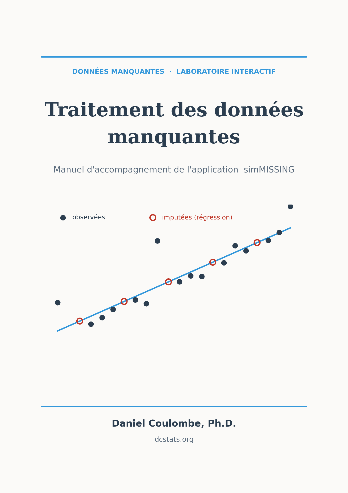

::: {.content-hidden when-format="epub"}

::: {.content-visible when-format="html"}

{fig-align="center" width="78%"}

:::

:::

# Préface {.unnumbered}

Ce n'est pas un manuel qu'on lit, c'est un **laboratoire qu'on manipule**. Il
accompagne pas à pas l'application **simManquant** : chaque idée y est d'abord
posée, puis **mise à l'épreuve dans l'application**, puis relue à la lumière de
ce qu'on vient d'y voir. Gardez donc l'application ouverte à côté de ces pages —
elles sont faites pour être parcourues ensemble.

## Une conviction : on retient ce qu'on manipule

On oublie l'essentiel de ce qu'on lit, mais on retient presque tout ce qu'on
*fait*. Ce guide est bâti sur ce principe. La théorie n'y est pas escamotée —
elle est solide, car on ne manipule bien que ce qu'on comprend — mais elle ne
vaut que par le geste qu'elle prépare. Lire cinq minutes, manipuler un quart
d'heure : voilà le bon rythme.

## Le rythme à trois temps

Chaque notion suit la même cadence, signalée par des encadrés :

::: {.app}
**À l'application —** on quitte la page pour aller *faire* quelque chose dans
simManquant : ouvrir un onglet précis, régler un contrôle nommé, observer un
résultat. Ces encadrés turquoise indiquent toujours le geste exact.
:::

::: {.voir}
**Ce qu'on doit voir —** de retour sur la page, on nomme l'observation attendue
et le point à retenir. Si ce qu'on a vu à l'écran ne correspond pas, c'est le
signal qu'il faut y regarder de plus près.
:::

Entre les deux vit le **concept** : la définition, la notation, l'argument. Trois
autres encadrés complètent le décor :

::: {.callout-note}
Un **repère conceptuel** : une définition, une notation, une mise en contexte.
:::

::: {.callout-tip}
Une **idée clé** : le point à retenir, souvent contre-intuitif.
:::

::: {.callout-warning}
Une **mise en garde** : un piège fréquent ou une limite à ne pas oublier.
:::

Deux sortes d'illustrations accompagnent le texte. Les **captures d'écran**
montrent l'application telle que vous la verrez, avec les réglages indiqués. Les
**figures explicatives**, produites hors de l'application, isolent une idée — une
forme de distribution, une courbe de probabilité, une règle de calcul — que
l'écran ne montre pas d'un seul coup.

## Lire un écran sans lui faire dire trop

L'application montre des nombres, des graphiques et des verdicts. Aucun de ces
objets ne constitue à lui seul une conclusion. Pour chaque écran, adoptez le même
réflexe en trois temps :

1. **Décrire.** Que montre exactement la sortie : une proportion, un patron, une
   différence entre estimations, une valeur-p, une trace d'algorithme ?
2. **Interpréter avec sa limite.** Quelle hypothèse ou quelle information cette
   sortie mobilise-t-elle ? Que ne permet-elle pas de savoir ?
3. **Décider de la suite.** Quel écran, quel argument de fond ou quelle analyse
   faut-il examiner ensuite ?

Les sections intitulées **Lire l'écran** dans ce manuel suivent cette discipline.
Elles ne répètent pas les cartes de l'application : elles les traduisent en
raisonnement. En particulier, la simulation permet de comparer une estimation à la
**vérité** génératrice; cette vérité n'existe jamais dans une étude réelle.

## Le fil conducteur

Une seule question gouverne tout le manuel : **pourquoi** une donnée manque
détermine **comment** la traiter. On la décline en suivant les onglets de
l'application — comprendre les mécanismes (MCAR, MAR, MNAR), les voir et les
simuler, diagnostiquer, traiter (cas complets, imputation simple, imputation
multiple, maximum de vraisemblance), puis évaluer et valider par la simulation.
Un terme reviendra sans cesse : le **prédicteur du manque**, cette variable dont
dépend la probabilité qu'une donnée s'absente. Toute la partie « traiter » se
joue autour de lui.

## Le plan de l'application

L'application s'organise en six onglets, parcourus de gauche à droite dans la
barre du haut. Le manuel suit le même ordre, à une exception près : la sensibilité
MNAR, rangée dans l'application avec le diagnostic, est traitée ici après les
méthodes d'évaluation.

| Onglet (sous-onglets) | Ce qu'on y fait | Chapitres |
|---|---|---|
| **Introduction** (Concepts · Bac à sable · Quiz · Bibliographie) | Voir les trois mécanismes sur 20 lignes; s'exercer à les reconnaître | 1, 2 |
| **Données & visualisation** (Données · Structure du manque · Mécanisme et traitement) | Simuler un jeu, l'amputer, décrire le manque | 3, 5 |
| **Traitements** | Comparer les méthodes à la vérité simulée | 5, 6, 7 |
| **Mécanisme du manque** (Diagnostic · Sensibilité MNAR) | Tester MCAR; encadrer un éventuel MNAR | 4, 10 |
| **Évaluer et valider** (Étude de simulation · Qualité de l'imputation) | Biais, efficacité, couverture; diagnostics d'imputation | 8, 9 |
| **Données réelles** | Appliquer la démarche à trois jeux classiques | 12 |

: Les onglets de simManquant et les chapitres correspondants. {#tbl-onglets}

## À qui s'adresse ce guide

Aux étudiantes et étudiants de cycles supérieurs en méthodes quantitatives, et
aux praticiens qui rencontrent des données manquantes dans leurs analyses. Une
familiarité avec la régression aide à saisir les concepts, sans être
indispensable : **l'application ne demande aucune programmation** — tout se fait
par des onglets, des menus et des curseurs.

## Accès à l'application

L'application **simManquant** s'utilise dans un simple navigateur web : il n'y a
rien à installer sur votre poste. Ouvrez-la à l'adresse
[shiny.dcstats.org/simMISSING](https://shiny.dcstats.org/simMISSING/) à côté de ce
guide et suivez, encadré après encadré, les gestes indiqués sous « À l'application ».

## Reproductibilité : le scénario de référence

Par défaut, chaque clic sur **Simuler / rééchantillonner** tire une **nouvelle
graine** : vous obtenez un nouveau jeu de données, et la graine utilisée s'affiche
dans le champ *Graine aléatoire*. Pour retrouver exactement un tirage, cochez
**Fixer la graine (reproductible)** et saisissez la graine voulue.

Toutes les captures de ce guide utilisent le même **scénario de référence**, que
vous pouvez reproduire à l'identique :

::: {.callout-note title="Scénario de référence"}
Onglet **Données & visualisation** : *N* = 400, 4 variables, ρ = 0,5; graine
**2416**, case *Fixer la graine* cochée. Mécanisme **MAR**, proportion de cas
incomplets 0,35, mode guidé, portée *Une seule*, variable rendue manquante $X_1$,
prédicteur du manque $X_2$, valeurs élevées vers manque. Cliquez ensuite sur
*Simuler / rééchantillonner*.
:::

Ce tirage a été choisi parce qu'il est **représentatif** : sur ce jeu, chaque
méthode se comporte comme elle le fait en moyenne sur de nombreux échantillons.
Un autre tirage donnera des nombres un peu différents, parfois trompeurs pris
isolément; c'est précisément ce que l'étude de simulation du @sec-etude-simulation
apprend à maîtriser.

## Remerciements

Ce guide et l'application qui l'accompagne s'inscrivent dans la lignée des
travaux fondateurs de Rubin [-@rubin1976; -@rubin1987], Little et Rubin
[-@littleRubin2019] et van Buuren [-@vanbuuren2018].
